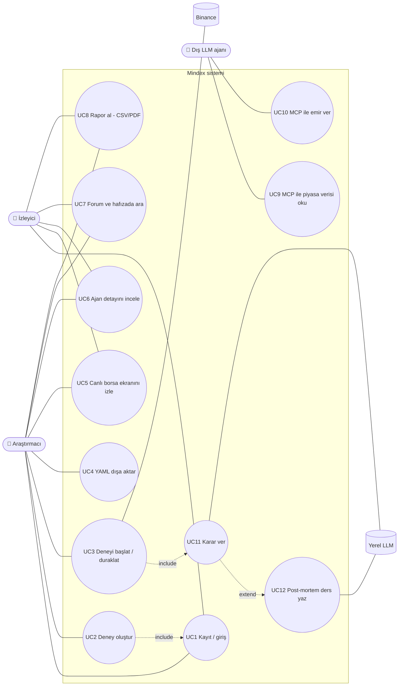

# 1. Use Case Modeli

> **Bu belge ne anlatır?** Mindex'i kimlerin kullandığını (aktörler) ve her birinin sistemle neler yapabildiğini (use case, yani kullanım senaryosu) gösterir. Her senaryo için ön koşulu, normal akışı ve bir şey ters gittiğinde ne olacağını tek tabloda toplar.
>
> **Neden önemli?** Sonraki bütün belgeler (mimari, akışlar, veritabanı) burada listelenen senaryoları gerçekleştirmek için tasarlanmıştır. Bir özelliğin neden var olduğunu merak ediyorsanız cevap buradadır.
>
> **İlgili isterler:** [F1 #7](https://github.com/recepbulbul/Mindex/issues/7) · [F2 #8](https://github.com/recepbulbul/Mindex/issues/8) · [F3 #9](https://github.com/recepbulbul/Mindex/issues/9) · [F4 #10](https://github.com/recepbulbul/Mindex/issues/10) · [F5 #11](https://github.com/recepbulbul/Mindex/issues/11) · [F6 #12](https://github.com/recepbulbul/Mindex/issues/12) · [F7 #13](https://github.com/recepbulbul/Mindex/issues/13) · [F8 #14](https://github.com/recepbulbul/Mindex/issues/14) · [F9 #15](https://github.com/recepbulbul/Mindex/issues/15) · [NF2 #17](https://github.com/recepbulbul/Mindex/issues/17) · [NF3 #18](https://github.com/recepbulbul/Mindex/issues/18) · [NF5 #20](https://github.com/recepbulbul/Mindex/issues/20)
>
> **İş paketi:** İP1 · **Sonraki belge:** [Sistem mimarisi](02-architecture.md) · Terimler için: [belge dizini ve sözlük](README.md#terimler-sözlüğü)

## Aktörler

Aktör, sistemle etkileşen kişi ya da dış sistemdir. *Birincil* aktörler sistemi bir amaçla kullanır; *ikincil* aktörler sisteme hizmet verir (veri, model, zamanlama).

| Aktör | Tür | Açıklama |
|---|---|---|
| Araştırmacı | Birincil, insan | Deney kurar, başlatır/durdurur, rapor alır (F1 rolü `researcher`) |
| İzleyici | Birincil, insan | Yalnızca canlı ekranı, ajan detayını, forumu ve raporları görür (F1 rolü `viewer`) |
| Dış LLM ajanı | Birincil, sistem | Başkasının yazdığı bir büyük dil modeli (LLM) ajanı; MCP (*Model Context Protocol*) sunucusu üzerinden arenaya katılır (F9) |
| Binance | İkincil, sistem | Geçmiş günlük fiyat özetleri (OHLCV: açılış, en yüksek, en düşük, kapanış, hacim; REST API ile) ve canlı fiyat (WebSocket ile) sağlar |
| Yerel LLM (llama.cpp) | İkincil, sistem | Dizüstünde çalışan Qwen3.5-9B modeli; ajanların günlük kararlarını ve post-mortem (işlem sonrası değerlendirme) derslerini üretir |
| Zamanlayıcı | İkincil, sistem | Gün sonu tetiklemesi, canlı modda periyodik karar döngüsü |

## Diyagram

**Nasıl okunur:** Soldaki yuvarlak kenarlı kutular aktörlerdir (👤 insan, 🤖 dış yazılım ajanı); silindirler veri ya da model sağlayan dış sistemlerdir (Binance, yerel LLM). Ortadaki "Mindex sistemi" çerçevesinin içindeki her daire bir kullanım senaryosudur (UC = *use case*). Düz çizgi, aktörün o senaryoya katıldığını gösterir: örneğin Araştırmacı sekiz senaryonun hepsine bağlıdır, İzleyici ise deney kuramaz ve başlatamaz, yalnızca izler. Kesikli oklar senaryolar arası ilişkidir: **include** "her zaman içerir" (deney başlatmak her gün karar vermeyi içerir), **extend** "bazen genişletir" (bir pozisyon kapandığında karar adımına post-mortem eklenir). Bu diyagramda hata dalı yoktur; hata durumları aşağıdaki tablonun "Alternatif / hata akışı" sütunundadır.

## Use case tanımları

Son sütundaki isterler [belge dizinindeki](README.md#isterler) GitHub issue'larına karşılık gelir. Hata akışlarındaki sayılar HTTP durum kodlarıdır: 401 kimlik doğrulanamadı, 403 yetki yok, 422 form verisi geçersiz, 429 çok fazla deneme. JWT (*JSON Web Token*), girişten sonra verilen ve kullanıcının rolünü taşıyan imzalı anahtardır.

| ID | Ad | Aktör | Ön koşul | Ana akış | Alternatif / hata akışı | İster |
|---|---|---|---|---|---|---|
| UC1 | Kayıt / giriş | Araştırmacı, İzleyici | — | E-posta + parola → JWT | Hatalı parola → 401, 5 denemede hız sınırı (429) | F1, NF3 |
| UC2 | Deney oluştur | Araştırmacı | Giriş yapılmış, rol `researcher` | Varlık, dönem, ajan seti, koşul (C0–C3), seed, komisyon seç → kaydet | Test dönemi doğrulama penceresiyle çakışırsa uyarı; geçersiz form → alan hatası | F2 |
| UC3 | Deneyi başlat / duraklat | Araştırmacı | Deney `draft` veya `paused` | Kuyruğa (Redis Streams) yazılır → işçi simülasyonu yürütür | İşçi çökerse checkpoint'ten devam | F3, F4, NF2 |
| UC4 | YAML dışa aktar | Araştırmacı | Deney mevcut | Yapılandırma YAML olarak indirilir | — | F2, NF5 |
| UC5 | Canlı ekranı izle | Herkes | Deney `running` | Mum grafiği, işlem işaretleri, lider tablosu WebSocket ile akar | Bağlantı kopar → istemci otomatik yeniden bağlanır | F5, NF1 |
| UC6 | Ajan detayı | Herkes | — | Portföy geçmişi, karar gerekçesi, kullanılan anılar, forum mesajları, güven skorları | — | F6 |
| UC7 | Forum / hafıza ara | Herkes | — | Mesaj akışı, güven grafiği; dersleri rejime göre filtrele, hibrit arama | — | F7 |
| UC8 | Rapor al | Herkes | Deney `completed` | Sharpe, MDD, getiri, sürü korelasyonu; koşul karşılaştırma; CSV/PDF | — | F8 |
| UC9–10 | MCP araçları | Dış LLM ajanı | MCP token'ı | `get_market_data`, `get_portfolio`, `place_order` | Başka ajanın portföyüne erişim → 403 | F9, NF3 |
| UC11 | Karar ver | Zamanlayıcı → LLM ajanı | Gün kapanışı | Gözlem → hafıza → forum → JSON karar | Bozuk JSON → 2 yeniden deneme → pozisyonu koru | NF2 |
| UC12 | Post-mortem | LLM ajanı | Pozisyon kapandı | Karşı-olgusal PnL tablosu → ders → tutarlılık kontrolü → pgvector | Tabloyla çelişen ders reddedilir | — |

UC11 ve UC12'nin adım adım işleyişi [Akış 2](03-flows.md#akış-2--llm-ajan-karar-döngüsü-nf2-nf3) ve [AI pipeline](04-ai-pipeline.md) belgelerindedir. Karşı-olgusal PnL tablosu, "bu işleme hiç girmeseydim / yarısıyla girseydim / zarar-kes koysaydım kâr-zararım (PnL) ne olurdu?" sorularının sayısal cevabıdır; pgvector, kabul edilen derslerin saklandığı vektör veritabanıdır.

---

[← Belge dizini](README.md) · [Sonraki: Sistem mimarisi →](02-architecture.md)
