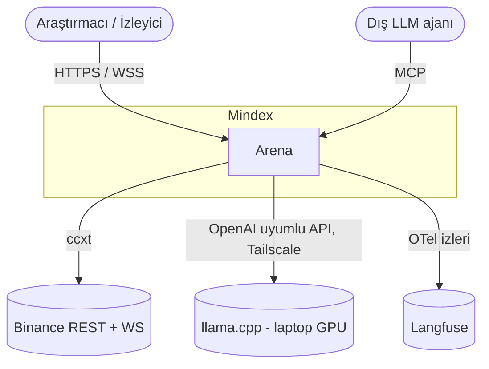
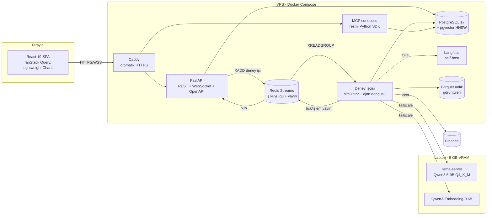

# 2. Sistem Mimarisi

> **Bu belge ne anlatır?** Mindex'in hangi parçalardan oluştuğunu, bu parçaların nerede çalıştığını (sunucu, dizüstü, tarayıcı) ve birbirleriyle nasıl haberleştiğini gösterir. Sonda, önemli tasarım kararları gerekçe ve alternatifleriyle özetlenir.
>
> **Neden önemli?** Kodun hangi klasörde ne iş yaptığını ve bir hatanın hangi bileşenden kaynaklanabileceğini anlamak için bu harita gerekir. Tasarım kararları tablosu, "neden böyle yaptınız?" sorusunun kısa cevabıdır.
>
> **İlgili isterler:** [F1 #7](https://github.com/recepbulbul/Mindex/issues/7) · [F3 #9](https://github.com/recepbulbul/Mindex/issues/9) · [F4 #10](https://github.com/recepbulbul/Mindex/issues/10) · [F5 #11](https://github.com/recepbulbul/Mindex/issues/11) · [F9 #15](https://github.com/recepbulbul/Mindex/issues/15) · [NF1 #16](https://github.com/recepbulbul/Mindex/issues/16) · [NF2 #17](https://github.com/recepbulbul/Mindex/issues/17) · [NF3 #18](https://github.com/recepbulbul/Mindex/issues/18) · [NF4 #19](https://github.com/recepbulbul/Mindex/issues/19) · [NF5 #20](https://github.com/recepbulbul/Mindex/issues/20)
>
> **İş paketi:** İP1 · **Önceki belge:** [Use case modeli](01-use-cases.md) · **Sonraki belge:** [Akış diyagramları](03-flows.md) · Terimler için: [belge dizini ve sözlük](README.md#terimler-sözlüğü)

Mindex dört katmandan oluşur: **Veri**, **Simülatör**, **Ajanlar**, **Sunum/Protokol**. Uzun süren deneyler web API'sinin (FastAPI) sürecinden ayrı bir arka plan sürecinde, yani bir işçide (*worker*) koşar; böylece bir deney saatlerce sürse de web arayüzü yanıt vermeye devam eder. Büyük dil modeli (LLM) sunucuda değil, ekran kartı (GPU) olan bir dizüstünde çalışır; sunucu ona Tailscale adlı şifreli özel ağ tüneliyle bağlanır.

Diyagramlar [C4 modeli](https://c4model.com/) adlı yaygın gösterimle çizilmiştir: seviye 1 sistemi dışarıdan tek kutu olarak, seviye 2 ise içindeki çalışan parçaları (konteynerleri) gösterir.

## Bağlam (C4 seviye 1)



**Nasıl okunur:** Ortadaki "Mindex" çerçevesi sistemin tamamıdır; içi bu seviyede gösterilmez. Yuvarlak kenarlı kutular sistemi kullananlardır, silindirler sistemin dışarıdan kullandığı hizmetlerdir. Okların üzerindeki yazı bağlantının nasıl kurulduğunu söyler: kullanıcılar tarayıcıdan şifreli web bağlantısıyla (HTTPS/WSS), dış ajanlar MCP protokolüyle gelir; Mindex, Binance'e ccxt kütüphanesiyle, yerel LLM'e OpenAI uyumlu API ile bağlanır ve her LLM çağrısının izini (OTel = OpenTelemetry) Langfuse'a gönderir.

## Konteynerler (C4 seviye 2)



**Nasıl okunur:** Üç çerçeve üç fiziksel yerdir: kullanıcının tarayıcısı, Docker Compose ile çalışan sunucu (VPS, kiralık sanal sunucu) ve ekran kartlı dizüstü. Kutular çalışan programlar, silindirler veri depolarıdır. Bir deneyin yolu şöyledir: tarayıcı isteği Caddy'ye (HTTPS sağlayan ön kapı) gelir, Caddy onu FastAPI'ye iletir; FastAPI deney işini Redis kuyruğuna yazar (`XADD`), işçi işi kuyruktan alır (`XREADGROUP`), simülasyonu yürütür, her gün için LLM'e karar sorar ve sonuçları PostgreSQL'e yazar. İşçinin ürettiği fiyat ve işlem olayları yine Redis üzerinden API'ye, oradan WebSocket ile tarayıcıya akar. Kesikli ok (OTel → Langfuse) ana akışı etkilemeyen, arka planda izleme kaydıdır. Bu diyagramda hata dalı yoktur; hatalar [akış diyagramlarında](03-flows.md) gösterilir.

## Katmanlar

Aşağıdaki kısaltmalar: OHLCV günlük fiyat özeti (açılış, en yüksek, en düşük, kapanış, hacim); PPO bir pekiştirmeli öğrenme algoritması; HMM piyasa rejimini tahmin eden gizli Markov modeli; 5 bp = %0,05 kayma (1 baz puan = %0,01). Simülatörün ayrıntıları [veri hattı ve simülatör belgesindedir](08-data-pipeline-baseline.md#3-simülatör-çekirdeği).

| Katman | Sorumluluk | Ana bileşenler |
|---|---|---|
| Veri | OHLCV, Fear & Greed, funding rate çekme; Parquet anlık görüntüleri; train/val/test ayrımı | ccxt, Polars, DuckDB |
| Simülatör | `t` kapanışında karar, `t+1` açılışında %0,1 komisyon + 5 bp kayma ile yürütme; long-only, kaldıraçsız; checkpoint | Saf Python, Gymnasium ortamı |
| Ajanlar | `BaseAgent` arayüzü; kural tabanlı (3), PPO (1), LLM (4); hafıza, forum, post-mortem | PydanticAI, Stable-Baselines3, hmmlearn, pgvector |
| Sunum / Protokol | REST, WebSocket, MCP; kimlik doğrulama; rapor | FastAPI, MCP SDK, React |

## MCP sunucusu (F9, NF3)

Dış ajanlar arenaya MCP sunucusu üzerinden bağlanır (`mindex.mcp`, resmî Python SDK, streamable HTTP, uç nokta `/mcp`). Sunucu tam üç araç sunar:

| Araç | Girdi | Çıktı |
|---|---|---|
| `get_market_data` | yok | Gün numarası, Fear & Greed, işlem maliyeti ve varlık başına LLM ajanlarının gördüğü göstergeler (son 30 günün getirileri, oynaklık, MA uzaklıkları, funding) |
| `get_portfolio` | yok | Çağıran ajanın özvarlığı, nakdi ve ağırlıkları (bugünün kapanışıyla) |
| `place_order` | `allocations` (`asset` kodu + `weight`), `confidence`, `rationale` | Emrin kabulü; günün ilerleyip ilerlemediği |

**Bağlanma:**

```bash
cd backend
uv run mindex mcp token --agent mcp-guest          # ajanın token'ı (varsayılan 7 gün)
uv run mindex mcp serve --agents mcp-guest          # http://127.0.0.1:8765/mcp, doğrulama dönemi
```

Dış ajan, MCP istemcisini `http://127.0.0.1:8765/mcp` adresine `Authorization: Bearer <token>` başlığıyla bağlar. Her gün için döngü: `get_market_data` → `get_portfolio` → `place_order`. Emir, yerel ajanların kararıyla aynı `Decision` doğrulamasından geçer (long-only, ağırlık toplamı ≤ 1, her varlık en çok bir kez, `confidence` 0–1, `rationale` 10–2000 karakter) ve simülatörün aynı adımıyla (`Simulator.step`) ertesi günün açılışında komisyon ve kaymayla gerçekleşir. Portföyü değiştirmemek için mevcut ağırlıklar yeniden gönderilir (özvarlığın %0,1'inden küçük farklar işlem yapmaz).

**Oturum (`ArenaSession`):** `mindex mcp serve` seçilen dönemin bellekteki bir tekrarını (replay) açar; her ajanın 10 000 USDT ile başlayan ayrı bir portföyü vardır. Oturum sıra tabanlıdır: gün, oturumdaki **bütün** ajanlar o günün emrini verince ilerler; aynı gün yeniden verilen emir öncekinin yerine geçer. Oturum bir deney değildir: veritabanına yazmaz, sunucu yeniden başlayınca sıfırlanır.

**Look-ahead:** Araçlar piyasayı yalnızca `MarketView` (bugünün kapanışına kadar) üzerinden okur; gelecekteki günleri değiştirmenin bugünkü yanıtı değiştirmediği testle kanıtlıdır. Yanıtlar LLM ajanlarının prompt'undaki biçimdedir: varlıklar `ASSET_A`…, tarih yerine gün numarası, fiyat düzeyi yerine getiriler (portföyde adet verilmez; adet + ağırlık fiyat düzeyini ele verirdi). `--split test` mühür nedeniyle reddedilir.

**Yetkilendirme (NF3):**

- Her ajanın kendi token'ı vardır: `MINDEX_JWT_SECRET` ile imzalı, kısa ömürlü bir JWT (HS256, algoritma sabit); `sub` ajanın kimliği, `aud` = `mindex-mcp`. Kullanıcı token'ı MCP'de, ajan token'ı REST API'de kabul edilmez (ikisi de testli).
- Token'sız, bozuk, süresi dolmuş ya da oturumda olmayan bir ajana ait token'lı istek HTTP 401 alır.
- Araçların hangi portföye dokunacağını yalnızca token belirler. `get_portfolio` ve `place_order`'daki isteğe bağlı `agent_id` başka bir ajanı gösterirse çağrı reddedilir ("Yetkisiz (403)"; MCP'de araç hataları HTTP durum kodu değil `isError` sonucu olarak döner) ve hiçbir portföy değişmez.
- Token iptali yoktur: sızan token süresi dolana kadar geçerlidir; hepsini birden iptal etmek için `MINDEX_JWT_SECRET` değiştirilir. Token'lar veritabanında saklanmaz.
- Sunucu varsayılan olarak yalnızca `127.0.0.1`'i dinler (SDK burada DNS rebinding korumasını açar). Geliştirme anahtarıyla (`change-me`) dışarıya açılmayı reddeder; dışarıya açılacaksa TLS sağlayan Caddy'nin arkasında çalıştırılmalıdır. Hız sınırlama henüz yoktur (NF3, #18).
- `rationale` dış ajandan gelen güvenilmeyen metindir; şu an hiçbir prompt'a girmez.

**Henüz yapılmayan: deney koşucusuna katılım.** MCP misafir ajanı kayıtlı bir deneyde (`mcp-guest`) hâlâ koşturulmaz; başlatma 422 verir. Neden: koşucu bir günü tek veritabanı işleminde, beklemeden işler ve yeniden başlatmada aynı sonucu bit bit üretir; dış ajanın emrini beklemek bu döngüye "gün başına bekleme" durumu ekler. Seçenekler:

1. **Beklemeden:** koşucu o gün için verilmiş emir yoksa portföyü korur. Basit, ama tekrar koşusu saniyeler sürdüğünden dış ajan yetişemez; yalnızca canlı modda (İP7, günde bir adım) anlamlıdır.
2. **Bekleyerek:** koşucu her gün misafirin emrini süre sınırıyla bekler, süre dolunca portföyü korur. Bunun için emirlerin veritabanında saklanması (yeni tablo ve migration), deneye `waiting` benzeri bir durum, token'ın deneye de bağlanması (`experiment_agent_id`) ve sürdürmede kayıtlı emirlerin yeniden oynatılması gerekir.

`ArenaSession` bu işin sınırıdır: koşucu aynı arayüzü (bugünün görünümü, ajanın portföyü, emir verme) veritabanı destekli bir oturumla sağladığında araçlar ve yetkilendirme değişmeden kalır.

## Temel tasarım kararları (ADR özeti)

ADR (*Architecture Decision Record*, mimari karar kaydı), her önemli tasarım kararını, gerekçesini ve neden başka bir yolun seçilmediğini kısaca yazan nottur. Tablodaki kısaltmalar: HNSW vektör aramasını hızlandıran indeks türü; MSW (*Mock Service Worker*) prototipin gerçek sunucu yokken sahte API ile çalışmasını sağlayan kütüphane; OWASP LLM01, LLM'lere yönelik en yaygın saldırı olan prompt injection (metne gizlenmiş talimatla modeli kandırma).

| # | Karar | Gerekçe | Alternatif |
|---|---|---|---|
| ADR-1 | Tek PostgreSQL'de ilişkisel + vektör veri (pgvector) | Tek yedek, tek işlem sınırı, JOIN ile hibrit arama | Ayrı vektör DB (Qdrant) — operasyon yükü |
| ADR-2 | Deney işçisi API'den ayrı, Redis Streams ile | Uzun deneyler HTTP isteğini bloklamaz; consumer group ile yeniden deneme | Celery — daha ağır |
| ADR-3 | Yerel LLM (llama.cpp), bulut yok | Maliyet sıfır, veri egemenliği, birebir tekrarlanabilirlik | Bulut API — look-ahead ve maliyet riski |
| ADR-4 | Karar adımında düşünme modu kapalı + JSON şeması ile kısıtlı üretim | p95 < 10 sn hedefi, bozuk JSON riskini azaltır | Serbest metin + regex — kırılgan |
| ADR-5 | Prototip MSW ile sahte API'ye bağlı | Aynı frontend kodu gerçek API'ye geçer; sözleşme önce tanımlanır | Statik HTML mock — atılır |
| ADR-6 | Forum mesajları güvenilmeyen veri | OWASP LLM01 prompt injection | — |
| ADR-7 | Kimlik: Argon2id parola özeti + kısa ömürlü JWT (HS256, algoritma sabit); İP8'e kadar `Authorization: Bearer` başlığı ve `sessionStorage` | Geliştirmede arayüz ile API ayrı origin'de; cookie için CORS + CSRF önlemi gerekirdi. `sessionStorage` sekme kapanınca silinir. İP8'de Caddy ikisini aynı origin'den sunduğunda httpOnly cookie'ye geçilir | Şimdiden httpOnly cookie — CSRF ve CORS yükü; `localStorage` — XSS'te kalıcı token |
| ADR-8 | MCP yetkisi: ajan başına imzalı JWT (`aud` = `mindex-mcp`); kimlik yalnızca token'dan, araç girdisinden değil | Şema değişikliği gerektirmez; kullanıcı token'larıyla karışmaz; başka portföye erişim yapısal olarak kapalı | Veritabanında özetlenmiş API anahtarı — iptal edilebilir ama tablo + migration ister (koşucu entegrasyonuyla birlikte) |

---

[← Belge dizini](README.md) · [← Önceki: Use case modeli](01-use-cases.md) · [Sonraki: Akış diyagramları →](03-flows.md)
