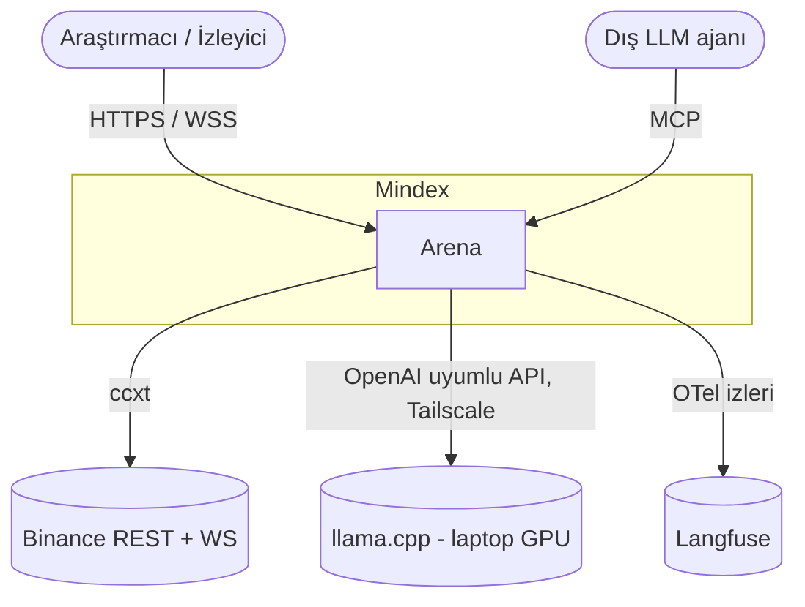
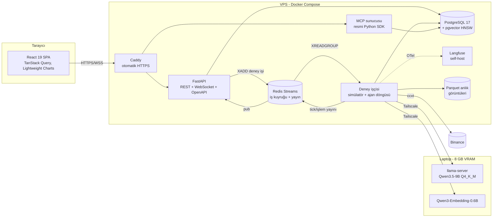

# 2. Sistem Mimarisi

> **Bu belge ne anlatır?** Mindex'in hangi parçalardan oluştuğunu, bu parçaların nerede çalıştığını (sunucu, dizüstü, tarayıcı) ve birbirleriyle nasıl haberleştiğini gösterir. Sonda, önemli tasarım kararları gerekçe ve alternatifleriyle özetlenir.
>
> **Neden önemli?** Kodun hangi klasörde ne iş yaptığını ve bir hatanın hangi bileşenden kaynaklanabileceğini anlamak için bu harita gerekir. Tasarım kararları tablosu, "neden böyle yaptınız?" sorusunun kısa cevabıdır.
>
> **İlgili isterler:** [F1 #7](https://github.com/recepbulbul/Mindex/issues/7) · [F3 #9](https://github.com/recepbulbul/Mindex/issues/9) · [F4 #10](https://github.com/recepbulbul/Mindex/issues/10) · [F5 #11](https://github.com/recepbulbul/Mindex/issues/11) · [F9 #15](https://github.com/recepbulbul/Mindex/issues/15) · [NF1 #16](https://github.com/recepbulbul/Mindex/issues/16) · [NF2 #17](https://github.com/recepbulbul/Mindex/issues/17) · [NF3 #18](https://github.com/recepbulbul/Mindex/issues/18) · [NF4 #19](https://github.com/recepbulbul/Mindex/issues/19) · [NF5 #20](https://github.com/recepbulbul/Mindex/issues/20)
>
> **İş paketi:** İP1 · **Önceki belge:** [Use case modeli](01-use-cases.md) · **Sonraki belge:** [Akış diyagramları](03-flows.md) · Terimler için: [belge dizini ve sözlük](README.md#terimler-sözlüğü)

Mindex dört katmandan oluşur: **Veri**, **Simülatör**, **Ajanlar**, **Sunum/Protokol**. Uzun süren deneyler web API'sinin (FastAPI) sürecinden ayrı bir arka plan sürecinde, yani bir işçide (*worker*) koşar; böylece bir deney saatlerce sürse de web arayüzü yanıt vermeye devam eder. Büyük dil modeli (LLM) sunucuda değil, ekran kartı (GPU) olan bir dizüstünde çalışır; sunucu ona Tailscale adlı şifreli özel ağ tüneliyle bağlanır.

Diyagramlar [C4 modeli](https://c4model.com/) adlı yaygın gösterimle çizilmiştir: seviye 1 sistemi dışarıdan tek kutu olarak, seviye 2 ise içindeki çalışan parçaları (konteynerleri) gösterir.

## Bağlam (C4 seviye 1)

**Nasıl okunur:** Ortadaki "Mindex" çerçevesi sistemin tamamıdır; içi bu seviyede gösterilmez. Yuvarlak kenarlı kutular sistemi kullananlardır, silindirler sistemin dışarıdan kullandığı hizmetlerdir. Okların üzerindeki yazı bağlantının nasıl kurulduğunu söyler: kullanıcılar tarayıcıdan şifreli web bağlantısıyla (HTTPS/WSS), dış ajanlar MCP protokolüyle gelir; Mindex, Binance'e ccxt kütüphanesiyle, yerel LLM'e OpenAI uyumlu API ile bağlanır ve her LLM çağrısının izini (OTel = OpenTelemetry) Langfuse'a gönderir.

## Konteynerler (C4 seviye 2)

**Nasıl okunur:** Üç çerçeve üç fiziksel yerdir: kullanıcının tarayıcısı, Docker Compose ile çalışan sunucu (VPS, kiralık sanal sunucu) ve ekran kartlı dizüstü. Kutular çalışan programlar, silindirler veri depolarıdır. Bir deneyin yolu şöyledir: tarayıcı isteği Caddy'ye (HTTPS sağlayan ön kapı) gelir, Caddy onu FastAPI'ye iletir; FastAPI deney işini Redis kuyruğuna yazar (`XADD`), işçi işi kuyruktan alır (`XREADGROUP`), simülasyonu yürütür, her gün için LLM'e karar sorar ve sonuçları PostgreSQL'e yazar. İşçinin ürettiği fiyat ve işlem olayları yine Redis üzerinden API'ye, oradan WebSocket ile tarayıcıya akar. Kesikli ok (OTel → Langfuse) ana akışı etkilemeyen, arka planda izleme kaydıdır. Bu diyagramda hata dalı yoktur; hatalar [akış diyagramlarında](03-flows.md) gösterilir.

## Katmanlar

Aşağıdaki kısaltmalar: OHLCV günlük fiyat özeti (açılış, en yüksek, en düşük, kapanış, hacim); PPO bir pekiştirmeli öğrenme algoritması; HMM piyasa rejimini tahmin eden gizli Markov modeli; 5 bp = %0,05 kayma (1 baz puan = %0,01). Simülatörün ayrıntıları [veri hattı ve simülatör belgesindedir](08-data-pipeline-baseline.md#3-simülatör-çekirdeği).

| Katman | Sorumluluk | Ana bileşenler |
|---|---|---|
| Veri | OHLCV, Fear & Greed, funding rate çekme; Parquet anlık görüntüleri; train/val/test ayrımı | ccxt, Polars, DuckDB |
| Simülatör | `t` kapanışında karar, `t+1` açılışında %0,1 komisyon + 5 bp kayma ile yürütme; long-only, kaldıraçsız; checkpoint | Saf Python, Gymnasium ortamı |
| Ajanlar | `BaseAgent` arayüzü; kural tabanlı (3), PPO (1), LLM (4); hafıza, forum, post-mortem | PydanticAI, Stable-Baselines3, hmmlearn, pgvector |
| Sunum / Protokol | REST, WebSocket, MCP; kimlik doğrulama; rapor | FastAPI, MCP SDK, React |

## Temel tasarım kararları (ADR özeti)

ADR (*Architecture Decision Record*, mimari karar kaydı), her önemli tasarım kararını, gerekçesini ve neden başka bir yolun seçilmediğini kısaca yazan nottur. Tablodaki kısaltmalar: HNSW vektör aramasını hızlandıran indeks türü; MSW (*Mock Service Worker*) prototipin gerçek sunucu yokken sahte API ile çalışmasını sağlayan kütüphane; OWASP LLM01, LLM'lere yönelik en yaygın saldırı olan prompt injection (metne gizlenmiş talimatla modeli kandırma).

| # | Karar | Gerekçe | Alternatif |
|---|---|---|---|
| ADR-1 | Tek PostgreSQL'de ilişkisel + vektör veri (pgvector) | Tek yedek, tek işlem sınırı, JOIN ile hibrit arama | Ayrı vektör DB (Qdrant) — operasyon yükü |
| ADR-2 | Deney işçisi API'den ayrı, Redis Streams ile | Uzun deneyler HTTP isteğini bloklamaz; consumer group ile yeniden deneme | Celery — daha ağır |
| ADR-3 | Yerel LLM (llama.cpp), bulut yok | Maliyet sıfır, veri egemenliği, birebir tekrarlanabilirlik | Bulut API — look-ahead ve maliyet riski |
| ADR-4 | Karar adımında düşünme modu kapalı + JSON şeması ile kısıtlı üretim | p95 < 10 sn hedefi, bozuk JSON riskini azaltır | Serbest metin + regex — kırılgan |
| ADR-5 | Prototip MSW ile sahte API'ye bağlı | Aynı frontend kodu gerçek API'ye geçer; sözleşme önce tanımlanır | Statik HTML mock — atılır |
| ADR-6 | Forum mesajları güvenilmeyen veri | OWASP LLM01 prompt injection | — |

---

[← Belge dizini](README.md) · [← Önceki: Use case modeli](01-use-cases.md) · [Sonraki: Akış diyagramları →](03-flows.md)
