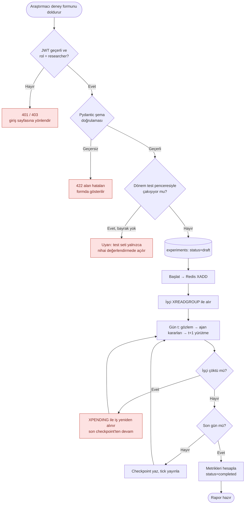
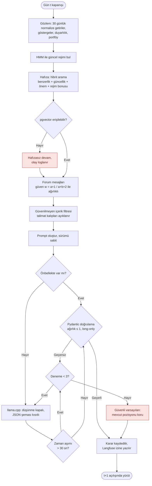
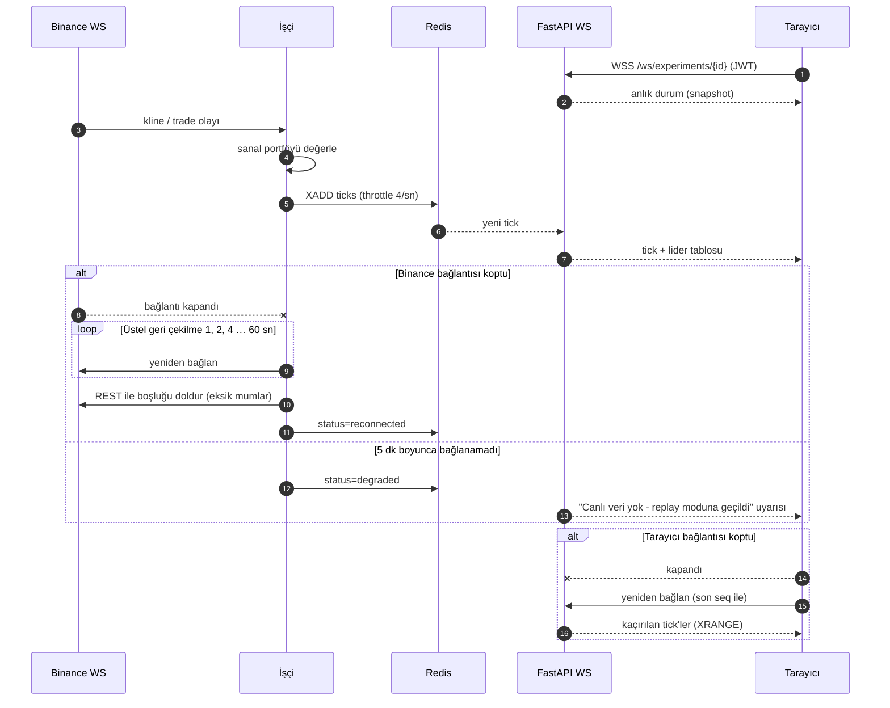

# 3. Akış Diyagramları (hata dallarıyla)

> **Bu belge ne anlatır?** Sistemin en kritik üç işleminin adım adım nasıl yürüdüğünü ve her adımda bir şey ters giderse sistemin ne yaptığını gösterir.
>
> **Neden önemli?** Mindex uzun süren deneyler yürütür ve dış hizmetlere (Binance, yerel LLM) bağımlıdır; bu hizmetler kesilebilir, LLM bozuk yanıt verebilir. Bu belge, böyle durumlarda deneyin çökmeyip güvenli biçimde devam ettiğini gösterir (güvenilirlik isteri NF2).
>
> **İlgili isterler:** [F2 #8](https://github.com/recepbulbul/Mindex/issues/8) · [F3 #9](https://github.com/recepbulbul/Mindex/issues/9) · [F4 #10](https://github.com/recepbulbul/Mindex/issues/10) · [F5 #11](https://github.com/recepbulbul/Mindex/issues/11) · [NF1 #16](https://github.com/recepbulbul/Mindex/issues/16) · [NF2 #17](https://github.com/recepbulbul/Mindex/issues/17) · [NF3 #18](https://github.com/recepbulbul/Mindex/issues/18) · [NF4 #19](https://github.com/recepbulbul/Mindex/issues/19)
>
> **İş paketi:** İP1 · **Önceki belge:** [Sistem mimarisi](02-architecture.md) · **Sonraki belge:** [AI pipeline](04-ai-pipeline.md) · Terimler için: [belge dizini ve sözlük](README.md#terimler-sözlüğü)

Üç kritik akış: (1) deney oluşturma ve yürütme, (2) LLM ajan karar döngüsü, (3) canlı paper-trading (sanal parayla, gerçek fiyatlarla işlem) veri akışı. Kırmızı düğümler hata dallarıdır. Başlıklardaki F/NF kodları akışın hangi isterleri karşıladığını gösterir.

## Akış 1 — Deney oluşturma ve yürütme (F2, F3, NF2)

**Nasıl okunur:** Yukarıdan aşağı okunur. Yuvarlak kenarlı kutular başlangıç ve bitiştir, dikdörtgenler adımlardır, eşkenar dörtgenler evet/hayır sorularıdır ve oklardaki yazı hangi cevapta hangi yola gidildiğini söyler. Silindir (`experiments: status=draft`) veritabanına kayıt anıdır. **Kırmızı kutular hata dallarıdır:**

- *401 / 403:* kullanıcı giriş yapmamış (401) ya da deney kurma yetkisi yok (403); giriş sayfasına yönlendirilir.
- *422:* formdaki bir alan geçersiz (Pydantic şema doğrulaması); hata ilgili alanın yanında gösterilir.
- *Test penceresi uyarısı:* seçilen dönem, yalnızca en sonda açılacak test dönemiyle çakışıyor; deney kaydedilmez (ayrıntı: [look-ahead protokolü](04-ai-pipeline.md#look-ahead-bias-protokolü)).
- *İşçi çöktü:* iş kaybolmaz; Redis'teki tamamlanmamış işler listesinden (`XPENDING`) yeniden alınır ve son kaydedilen günden (checkpoint) devam edilir. Ok tekrar "Gün t" adımına döner.

Sağdaki "Hayır" döngüsü (checkpoint yaz → sonraki gün) simülasyonun gün gün ilerlemesidir. `XADD` / `XREADGROUP` Redis kuyruğuna iş yazma ve kuyruktan iş alma komutlarıdır; JWT, girişte verilen kimlik anahtarıdır.

## Akış 2 — LLM ajan karar döngüsü (NF2, NF3)

**Nasıl okunur:** Bir LLM ajanının tek bir günlük kararı yukarıdan aşağı izlenir. Ajan önce piyasayı gözlemler, piyasanın rejimini (yükseliş/düşüş/yatay) HMM (gizli Markov modeli) ile belirler, hafızasından benzer geçmiş dersleri çağırır ve forumdaki mesajları, gönderenlere duyduğu güvene göre ağırlıklandırarak okur. Güven formülü `w = (a+1)/(a+b+2)`'dir; `a` gönderenin doğrulanan, `b` çürüyen tavsiye sayısıdır. Forum mesajları modele verilmeden önce talimat kalıplarından temizlenir (prompt injection'a karşı, NF3). Ardından LLM'den JSON biçiminde karar istenir ve karar Pydantic ile denetlenir (ağırlıklar toplamı ≤ 1, açığa satış yok). **Kırmızı kutular hata dallarıdır:**

- *pgvector erişilemiyor:* hafıza veritabanına ulaşılamazsa ajan hafızasız devam eder, olay loglanır; deney durmaz.
- *Güvenli varsayılan:* LLM 30 saniyede cevap vermezse ya da yanıt geçersizse yeniden denenir; toplam 3 denemede geçerli karar çıkmazsa ajan hiçbir işlem yapmaz, mevcut pozisyonunu korur.

Her durumda karar kaydedilir ve ertesi günün (`t+1`) açılış fiyatıyla yürütülür; bu, ajanın kararını verdiği günün kapanışından sonraki fiyatları görmemesini sağlar.

Bu akışın doğrulama/yeniden deneme kısmı [`backend/src/mindex/domain/decision.py`](../backend/src/mindex/domain/decision.py) içinde uygulanmış ve test edilmiştir. P3'te gözlem, llama.cpp çağrısı (düşünme kapalı, JSON şeması), zaman aşımı ve pozisyonu koruma dalları [`backend/src/mindex/agents/llm.py`](../backend/src/mindex/agents/llm.py) içinde eklendi; rejim, hafıza, forum ve önbellek adımları P4–P6'dadır.

## Akış 3 — Canlı paper-trading veri akışı (F4, F5, NF1)

**Nasıl okunur:** Bu bir sıralama (*sequence*) diyagramıdır. Her sütun bir katılımcıdır (Binance canlı akışı, işçi, Redis, API, tarayıcı); zaman yukarıdan aşağı akar ve numaralı oklar mesajların sırasını gösterir. Düz ok istek ya da olay, kesikli ok cevaptır; ucunda `x` olan ok bağlantının koptuğunu gösterir. Ana akış: tarayıcı canlı bağlantıyı açar, Binance'ten gelen her fiyat olayı (*tick*) ile işçi sanal portföyleri yeniden değerler ve sonucu saniyede en fazla 4 kez Redis'e yazar; API bunu tarayıcıya iletir. Gri `alt` kutuları hata senaryolarıdır (bu diyagram türünde renkli kutu yoktur):

- *Binance bağlantısı koptu:* işçi 1, 2, 4 … 60 saniye artan aralıklarla yeniden bağlanmayı dener (üstel geri çekilme), arada kaçan mumları REST API'den tamamlar.
- *5 dakika boyunca bağlanamadı:* deney "bozulmuş" (`degraded`) durumuna geçer, kullanıcıya canlı veri olmadığı ve replay (geçmiş verinin yeniden oynatılması) moduna geçildiği bildirilir.
- *Tarayıcı bağlantısı koptu:* tarayıcı son aldığı sıra numarasıyla yeniden bağlanır, kaçırdığı tick'ler Redis'ten (`XRANGE`) geri gönderilir.

---

[← Belge dizini](README.md) · [← Önceki: Sistem mimarisi](02-architecture.md) · [Sonraki: AI pipeline →](04-ai-pipeline.md)
