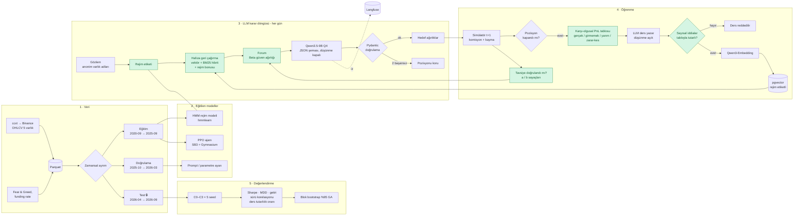

# 4. AI Pipeline

> **Bu belge ne anlatır?** Verinin toplanmasından modellerin eğitilmesine, LLM ajanının günlük kararından işlem sonrası ders çıkarmasına ve deneylerin değerlendirilmesine kadar yapay zekâ hattının tamamını tek diyagramda gösterir. Ayrıca geleceği görme hatasına karşı alınan önlemleri ve deney koşullarını (C0–C3) tanımlar.
>
> **Neden önemli?** Projenin araştırma sorusu (hafıza ve paylaşım işe yarıyor mu?) bu hattaki koşulların karşılaştırılmasıyla cevaplanır. Sonuçların güvenilir olması için modelin test dönemini önceden "bilmemesi" gerekir; bu belge bunun nasıl sağlandığını anlatır.
>
> **İlgili isterler:** [F3 #9](https://github.com/recepbulbul/Yunus_Hoca_Proje/issues/9) · [F7 #13](https://github.com/recepbulbul/Yunus_Hoca_Proje/issues/13) · [F8 #14](https://github.com/recepbulbul/Yunus_Hoca_Proje/issues/14) · [NF2 #17](https://github.com/recepbulbul/Yunus_Hoca_Proje/issues/17) · [NF3 #18](https://github.com/recepbulbul/Yunus_Hoca_Proje/issues/18) · [NF4 #19](https://github.com/recepbulbul/Yunus_Hoca_Proje/issues/19) · [NF5 #20](https://github.com/recepbulbul/Yunus_Hoca_Proje/issues/20)
>
> **İş paketi:** İP1 (tasarım); uygulama İP3–İP6 · **Önceki belge:** [Akış diyagramları](03-flows.md) · **Sonraki belge:** [ER diyagramı](05-er-diagram.md) · Terimler için: [belge dizini ve sözlük](README.md#terimler-sözlüğü)

Yeşil düğümler projenin özgün bileşenleridir: karşı-olgusal post-mortem (işlem kapandıktan sonra "başka ne yapabilirdim?" analizi), rejim farkındalıklı hafıza, güven tabanlı forum.

**Nasıl okunur:** Diyagram soldan sağa beş numaralı bölümden oluşur; her çerçeve bir aşamadır.

1. **Veri:** Binance'ten 5 varlığın günlük fiyatları (OHLCV), Fear & Greed endeksi ve funding rate çekilip Parquet dosyalarına yazılır, sonra zamana göre eğitim / doğrulama / test olarak üçe bölünür. 🔒 işareti test verisinin mühürlü olduğunu, yalnızca nihai değerlendirmede açıldığını gösterir.
2. **Eğitilen modeller:** Eğitim verisiyle piyasa rejimini bulan HMM (gizli Markov modeli, `hmmlearn`) ve pekiştirmeli öğrenme ajanı PPO (Stable-Baselines3 = SB3, Gymnasium ortamında) eğitilir; doğrulama verisiyle prompt ve parametreler ayarlanır.
3. **LLM karar döngüsü:** Her gün ajan gözlem yapar, rejim etiketini alır, hafızasından ilgili dersleri çağırır (anlam benzerliği + BM25 anahtar kelime araması), forumu okur ve LLM'den hedef portföy ağırlıklarını ister. Doğrulama iki kez başarısız olursa pozisyon korunur ([Akış 2](03-flows.md#akış-2--llm-ajan-karar-döngüsü-nf2-nf3)).
4. **Öğrenme:** Karar simülatörde ertesi gün komisyon ve kayma ile yürütülür. Pozisyon kapanınca karşı-olgusal kâr/zarar (PnL) tablosu hesaplanır, LLM bundan bir ders yazar. Dersteki sayısal iddialar tabloyla çelişiyorsa ders reddedilir; tutarlıysa vektöre çevrilip (Qwen3-Embedding) rejim etiketiyle hafızaya (pgvector) yazılır. Aynı zamanda forumdaki tavsiyelerin tutup tutmadığı sayılır (`a` / `b`) ve güven skorları güncellenir.
5. **Değerlendirme:** Test döneminde her koşul (C0–C3) 5 farklı seed ile koşulur; Sharpe, MDD (maksimum düşüş), getiri, sürü korelasyonu ve ders tutarlılık oranı hesaplanır. Koşullar arası farkların tesadüf olup olmadığı blok bootstrap ile %95 güven aralığında (GA) sınanır.

Bölümler arasındaki oklar verinin aktığı yönü gösterir; hafızadan (`pgvector`) karar döngüsüne ve güven sayaçlarından foruma geri dönen oklar, ajanın zamanla öğrenmesini sağlayan **geri besleme döngüleridir**. Kesikli ok (`iz` → Langfuse) her LLM çağrısının izleme kaydıdır. **Yeşil kutular** projenin özgün katkılarıdır. Bu diyagramda kırmızı hata kutusu yoktur; "pozisyonu koru" ve "ders reddedilir" dalları buradaki hata/ret yollarıdır, ayrıntıları [akış diyagramlarındadır](03-flows.md).

## Look-ahead bias protokolü

Look-ahead bias (geleceği görme hatası), modelin karar anında henüz bilinmemesi gereken bilgiye erişmesidir. LLM'ler internetten toplanan verilerle eğitildiği için geçmiş fiyatları ezberlemiş olabilir; bu durumda test sonuçları gerçekçi olmaz. Aşağıdaki dört kural bunu önler. Uygulamadaki karşılığı: [test setinin ayrılması](08-data-pipeline-baseline.md#2-test-setinin-ayrılması-look-ahead-protokolü).

1. Test dönemi (Nisan–Eylül 2026) model yayımından (2 Mart 2026) sonradır.
2. Test verisi yalnızca nihai değerlendirmede açılır; CI'da test Parquet'i okunursa hata verilir.
3. Prompt'larda varlık adları (`ASSET_A`…) ve tarihler (`gün 0…N`) anonimleştirilir.
4. Kasım–Aralık 2026 canlı paper-trading hiç görülmemiş veride ileri testtir.

## Deney koşulları (ablasyon)

Ablasyon, bir sistemin parçalarını tek tek kapatıp her parçanın etkisini ölçmektir. C0'dan C3'e doğru her koşul bir özellik ekler; iki komşu koşulun farkı, eklenen özelliğin etkisini verir. Örneğin C1 − C0 kişisel hafızanın, C3 − C2 güven ağırlığının etkisidir. C1′, rejim bonusunun katkısını ayırmak için eklenmiştir. "Beta" güven ağırlığı, yukarıdaki `(a+1)/(a+b+2)` formülüdür.

| Koşul | Kişisel hafıza | Forum | Güven ağırlığı |
|---|:-:|:-:|:-:|
| C0 | — | — | — |
| C1 | ✔ | — | — |
| C1′ (rejimsiz) | ✔ (rejim bonusu yok) | — | — |
| C2 | ✔ | ✔ | eşit |
| C3 | ✔ | ✔ | Beta |

---

[← Belge dizini](README.md) · [← Önceki: Akış diyagramları](03-flows.md) · [Sonraki: ER diyagramı →](05-er-diagram.md)
