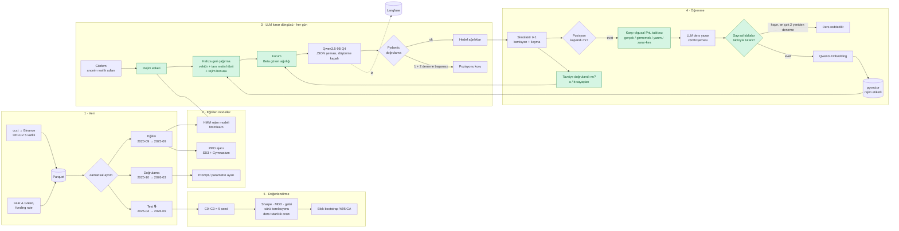

# 4. AI Pipeline

> **Bu belge ne anlatır?** Verinin toplanmasından modellerin eğitilmesine, LLM ajanının günlük kararından işlem sonrası ders çıkarmasına ve deneylerin değerlendirilmesine kadar yapay zekâ hattının tamamını tek diyagramda gösterir. Ayrıca geleceği görme hatasına karşı alınan önlemleri ve deney koşullarını (C0–C3) tanımlar.
>
> **Neden önemli?** Projenin araştırma sorusu (hafıza ve paylaşım işe yarıyor mu?) bu hattaki koşulların karşılaştırılmasıyla cevaplanır. Sonuçların güvenilir olması için modelin test dönemini önceden "bilmemesi" gerekir; bu belge bunun nasıl sağlandığını anlatır.
>
> **İlgili isterler:** [F3 #9](https://github.com/recepbulbul/Mindex/issues/9) · [F7 #13](https://github.com/recepbulbul/Mindex/issues/13) · [F8 #14](https://github.com/recepbulbul/Mindex/issues/14) · [NF2 #17](https://github.com/recepbulbul/Mindex/issues/17) · [NF3 #18](https://github.com/recepbulbul/Mindex/issues/18) · [NF4 #19](https://github.com/recepbulbul/Mindex/issues/19) · [NF5 #20](https://github.com/recepbulbul/Mindex/issues/20)
>
> **İş paketi:** İP1 (tasarım); uygulama İP3–İP6 · **Önceki belge:** [Akış diyagramları](03-flows.md) · **Sonraki belge:** [ER diyagramı](05-er-diagram.md) · Terimler için: [belge dizini ve sözlük](README.md#terimler-sözlüğü)

Yeşil düğümler projenin özgün bileşenleridir: karşı-olgusal post-mortem (işlem kapandıktan sonra "başka ne yapabilirdim?" analizi), rejim farkındalıklı hafıza, güven tabanlı forum.

**Nasıl okunur:** Diyagram soldan sağa beş numaralı bölümden oluşur; her çerçeve bir aşamadır.

1. **Veri:** Binance'ten 5 varlığın günlük fiyatları (OHLCV), Fear & Greed endeksi ve funding rate çekilip Parquet dosyalarına yazılır, sonra zamana göre eğitim / doğrulama / test olarak üçe bölünür. 🔒 işareti test verisinin mühürlü olduğunu, yalnızca nihai değerlendirmede açıldığını gösterir.
2. **Eğitilen modeller:** Eğitim verisiyle piyasa rejimini bulan HMM (gizli Markov modeli, `hmmlearn`) ve pekiştirmeli öğrenme ajanı PPO (Stable-Baselines3 = SB3, Gymnasium ortamında) eğitilir; doğrulama verisiyle prompt ve parametreler ayarlanır.
3. **LLM karar döngüsü:** Her gün ajan gözlem yapar, rejim etiketini alır, hafızasından ilgili dersleri çağırır (anlam benzerliği + PostgreSQL tam metin araması; ayrıntı: [Kalıcı hafıza](#kalıcı-hafıza)), forumu okur ve LLM'den hedef portföy ağırlıklarını ister. İlk deneme ve 2 yeniden deneme (toplam 3) geçerli karar üretmezse pozisyon korunur ([Akış 2](03-flows.md#akış-2--llm-ajan-karar-döngüsü-nf2-nf3)).
4. **Öğrenme:** Karar simülatörde ertesi gün komisyon ve kayma ile yürütülür. Pozisyon kapanınca karşı-olgusal kâr/zarar (PnL) tablosu hesaplanır, LLM bundan bir ders yazar (ayrıntı: [Karşı-olgusal post-mortem](#karşı-olgusal-post-mortem)). Dersteki sayısal iddialar tabloyla çelişiyorsa LLM gerekçeyle yeniden denenir, yine çelişiyorsa ders reddedilir; tutarlıysa vektöre çevrilip (Qwen3-Embedding) rejim etiketiyle hafızaya (pgvector) yazılır. Aynı zamanda forumdaki tavsiyelerin tutup tutmadığı sayılır (`a` / `b`) ve güven skorları güncellenir.
5. **Değerlendirme:** Test döneminde her koşul (C0–C3) 5 farklı seed ile koşulur; Sharpe, MDD (maksimum düşüş), getiri, sürü korelasyonu ve ders tutarlılık oranı hesaplanır. Koşullar arası farkların tesadüf olup olmadığı blok bootstrap ile %95 güven aralığında (GA) sınanır.

Bölümler arasındaki oklar verinin aktığı yönü gösterir; hafızadan (`pgvector`) karar döngüsüne ve güven sayaçlarından foruma geri dönen oklar, ajanın zamanla öğrenmesini sağlayan **geri besleme döngüleridir**. Kesikli ok (`iz` → Langfuse) her LLM çağrısının izleme kaydıdır. **Yeşil kutular** projenin özgün katkılarıdır. Bu diyagramda kırmızı hata kutusu yoktur; "pozisyonu koru" ve "ders reddedilir" dalları buradaki hata/ret yollarıdır, ayrıntıları [akış diyagramlarındadır](03-flows.md).

## Rejim modeli

Kod: `backend/src/mindex/regime/` (`hmm.py`, `report.py`). Üç durumlu Gauss HMM (`hmmlearn`), eşit ağırlıklı sepetin günlük log getirilerinden türetilen özelliklerle yalnızca eğitim döneminde eğitilir. Her günün etiketi **filtrelenmiş** olasılığın (`P(durum_t | x_1..x_t)`, ileri geçiş) en büyüğüdür; Viterbi ya da düzleştirilmiş olasılık geleceği okuduğu için kullanılmaz. Durumların adı (boğa / ayı / yatay) eğitimde bir kez sabitlenir ve artefakta (`models/regime-hmm.json`, JSON + SHA-256) yazılır.

**Etiketleme (`mindex train-hmm --labeling`).** Durumların nasıl adlandırılacağı seçilebilir. Seçim artefakttaki `labeling` ve `features` alanlarına yazılır; koşucu yöntemi ve özellikleri yalnızca artefakttan okur, deney `config`'ine `regime_labeling` olarak kaydeder.

| `--labeling` | Özellikler | Adlandırma |
|---|---|---|
| `momentum` (varsayılan, ilk yöntem) | 14 günlük momentum, 14 günlük volatilite | ortalama momentumu en yüksek durum boğa, en düşük ayı, ortadaki yatay |
| `trend-30` | + 30 günlük trend (günlük log getiri ortalaması) | ortalama 30 günlük trende göre; volatilite yalnızca ikinci eksen |
| `return-60` | varsayılanla aynı | her durumun eğitim günlerindeki geriye dönük 60 günlük sepet getirisinin (filtrelenmiş olasılıkla ağırlıklı) ortalamasına göre |
| `vol-first` | varsayılanla aynı | en sakin durum (en düşük ortalama volatilite) yatay; kalan ikisinden momentumu yüksek olan boğa, düşük olan ayı |

Her yöntem her rejimi tam bir kez kullanır. Adlandırma eğitim verisiyle bir kez yapılır, bir günün etiketi yine yalnızca o güne kadarki veriye bakar; önek ve filtrelenmiş olasılık testleri her yöntem için koşar. Artefakt sürümü 3'tür; `labeling` alanı olmayan sürüm 2 dosyaları "yeniden eğitin" hatasıyla reddedilir.

**Neden?** Gerçek veride (#50) varsayılan yöntemin etiketleri trendle tutarsız çıktı: doğrulama döneminde BTC −%42,4 iken ayı günlerin yalnızca %15,4'ü, boğa %41,2'siydi; "boğa" günlerinin ertesi günkü getirisi ayınınkinden düşüktü. C1'in rejim bonusu bu etiketlere dayandığı için yöntem, aşağıdaki tanı tablosuyla seçilecek.

**Tanı (`mindex regime-report`, `train-hmm` sonunda da çalışır).** Eğitim ve doğrulama bölmeleri için her etiketin gün payını, ortalama süresini (ardışık gün), geriye dönük 30 günlük ve ileriye dönük 1/5/20 günlük sepet ve BTC getirisini (`exp(Σ log getiri) − 1`) ve "tutarlılık" özetini (boğa > yatay > ayı sırası her getiride tutuyor mu; bir etiketin değeri yoksa "belirsiz") yazar. Çıktı `reports/regime-report-<labeling>.json` ve issue'ya yapıştırılabilir `.md` tablosudur.

- **İleriye dönük getiriler yalnızca değerlendirme içindir.** Karar yolunda, etiketlemede ya da eğitimde kullanılmaz; `report.py`'yi karar yolundaki hiçbir modül içe aktarmaz.
- Ufku bölmenin sonunu aşan günler (doğrulamanın son 20 günü) dışarıda kalır, bir sonraki bölmeden okunmaz; her ortalamanın yanında `n` vardır.
- Test bölmesi hiçbir zaman okunmaz: iki bölme de `ensure_readable`'dan mühür açılmadan geçer.

## Kalıcı hafıza

Kod: `backend/src/mindex/memory/` (`embedder.py`, `store.py`). Her ders `memories` tablosunda; `embedding` (pgvector, 1024 boyut, HNSW) ve `lesson_tsv` (`to_tsvector('simple', lesson)`, GIN) sütunlarıyla tutulur.

- **Yazma:** `MemoryStore.add(...)` dersi `Embedder` ile vektöre çevirir ve oturuma ekler (`flush`; commit çağırana aittir). Gerçekte `LlamaServerEmbedder` llama-server'ın OpenAI uyumlu `/v1/embeddings` ucuna gider (`MINDEX_EMBEDDING_BASE_URL`); testlerde model gerektirmeyen, deterministik `HashEmbedder` kullanılır.
- **Hibrit arama:** `MemoryStore.search(...)` sorguyu vektöre çevirir; ajanın uygun bütün derslerini pgvector kosinüs uzaklığı ve `ts_rank` ile puanlar. Tam metin sorgusu `websearch_to_tsquery('simple', ...)` ile kurulur, ama sorgunun kelimeleri `or` ile bağlanır: varsayılan VE bağlacıyla cümle gibi bir sorgu, yalnızca bütün kelimeleri içeren derslerle eşleşirdi. (`ts_rank` BM25 değildir; PostgreSQL'in yerleşik sıralamasıdır.)
- **Skor birleştirme:** `fuse_scores` saf fonksiyondur ve karşılıklı sıra füzyonu (RRF, `k = 10`) kullanır. İki sinyalin ölçekleri farklı olduğu ve min-max tek aday ya da eşit skorlarda bozulduğu için ağırlıklı min-max yerine RRF seçildi. Hiçbir sorgu kelimesini içermeyen ders tam metin payı almaz. RRF yalnızca sıraya baktığı için uzaklığın büyüklüğünü atar; bu yüzden birleşik değer mutlak kosinüs benzerliğiyle çarpılır (sürekli bir ilgi tabanı). Sabit bir uzaklık eşiği gerçek modelin benzerlik aralığına bağlı olurdu. Sonuç `[0, 1]` aralığındadır (`decision_memories.score`):
  `ilgi = RRF × max(0, 1 − kosinüs_uzaklığı)`
  `skor = ilgi × (0,7 + 0,3 × önem) × (1 + 0,2 × rejim_eşleşmesi) / 1,2`
  **Gerçek sınır:** Önem ve rejim bonusu bir skoru en fazla `1,2 / 0,7 ≈ 1,71` kat büyütür. Yani bir ders, başka bir dersi ancak ilgisi onunkinin yaklaşık %58'i ya da daha fazlasıysa geçebilir. Uzaklığı 0,99 olan ders, 0,01 olanı bonuslarla geçemez; birbirine yakın iki ders arasında ise rejim bonusu sırayı değiştirebilir. Bedeli: vektör benzerliği sıfır olan bir tam metin eşleşmesi 0 puan alır. Sabitler (`RRF_K`, `IMPORTANCE_WEIGHT`, `REGIME_BONUS`) yalnızca doğrulama döneminde ayarlanır.
- **Rejim bonusu:** Dersin rejimi bugünkü rejimle aynıysa ilgi ×1,2 olur. C1′ (`C1_NO_REGIME`) koşulunda `use_regime=False` ile bonus kapanır; diğer her şey C1 ile aynıdır, böylece C1 − C1′ farkı yalnızca bonusun etkisini ölçer.
- **Look-ahead kuralı:** Yalnızca `day < as_of_day` olan dersler döner. Bugün öğrenilen ders bugünkü kararda kullanılamaz. Filtre SQL'in `WHERE` koşulundadır, sonradan elenmez; DB testi aynı günün ve sonraki günün derslerini sorguyla birebir aynı yazıp dönmediklerini kanıtlar.
- **Sahiplik:** Yalnızca o ajanın (`experiment_agent_id`) kendi dersleri döner (C1, C1′, C2, C3). Paylaşım forumun işidir ([Güven ağırlıklı forum](#güven-ağırlıklı-forum-c2c3)).
- Aday adımında `ORDER BY embedding <=> q LIMIT n` kullanılmaz. HNSW taraması süzmeyi indeks yürüyüşünden sonra yapar ve az anısı olan bir ajan için `k`'den az satır döndürebilir. Bir ajanın bir koşudaki dersi birkaç yüzü geçmez, tam tarama ucuzdur.

## Karşı-olgusal post-mortem

Kod: `backend/src/mindex/postmortem/` (`counterfactual.py`, `lesson.py`). Deney koşucusuna bağlanması sonraki adımdır; modül şimdilik saf fonksiyonlar ve `postmortem(...)` giriş noktasından oluşur.

- **Tetikleme:** Bir *gidiş-dönüş* (round trip), bir ajanın bir varlıktaki dolumlarının sıfırdan sıfıra koşusudur: elde hiç yokken alımla açılır, eldeki miktarı (sayısal toleransla) sıfıra indiren satışla kapanır. Aradaki ekleme ve kısmi satışlar aynı gidiş-dönüşe aittir; kısmi satış post-mortem tetiklemez. `closed_on(fills, day)` o gün kapanan gidiş-dönüşleri verir.
- **Tablo:** Dört senaryo, karşılaştırılabilir olsun diye hepsi gerçek gidiş-dönüşün giriş maliyetine (alım tutarı + komisyon) oranla verilir. Veritabanında `memories.counterfactual = {actual, skip, half, stop_loss}`, API'de `Counterfactual {actual, skip, half, stopLoss}` olarak tutulur.
  - `actual`: gerçekleşen dolumların PnL'i. Dolumlarda kayma ve komisyon zaten vardır.
  - `skip`: hiç girmemek, her zaman 0.
  - `half`: bütün dolumlar yarım miktarla. Kayma ve komisyon orantılı olduğu için tam olarak `actual / 2` çıkar.
  - `stop_loss`: aynı dolumlar, ama gün içi düşük, o ana kadarki alımların ortalama giriş fiyatının (kayma dahil) `(1 − stop_pct)` katına inince elde ne varsa satılır. Varsayılan `stop_pct` %5'tir ve parametreyle değişir. Tetiklenmeden sonraki dolumlar yapılmamış sayılır. Çıkış simülatörün `rebalance` fonksiyonuyla yapılır, yani aynı kayma ve komisyonu öder. Gün eşiğin altında açılırsa (boşluk) satış eşik fiyatından değil, açılıştan yapılır.
- **Look-ahead:** Hesap yalnızca giriş gününden kapanış gününe kadarki barları okur; post-mortem kapanış gününün kapanışında yapılır. Gün içi sıra varsayımı: dolumlar `Fill.day` açılışında gerçekleşir (simülatördeki gibi), düşük açılıştan sonra gelir. Bu yüzden giriş gününün düşüğü zarar-kesi tetikleyebilir, kapanış gününün düşüğü tetikleyemez (pozisyon o açılışta satılmıştır). Test, piyasayı kapanış gününde kesince ya da sonraki barları bozunca sonucun birebir aynı kaldığını kanıtlar.
- **Ders (`postmortem-v1`):** Prompt'ta yalnızca yüzdeler, anonim varlık kodu (`ASSET_x`, `anonymise`) ve elde tutma süresi (gün sayısı) bulunur; fiyat düzeyi ya da takvim tarihi yoktur. Çıktı JSON şemasıyla sınırlıdır: `lesson` (20–2000 karakter), `importance` (0–1), `regime`, `outcome` (kazanç / kayıp / yatay) ve `best_scenario`. Sınırlar `memories` CHECK kısıtlarıyla aynıdır; ihlal veritabanı hatası olarak değil, ret olarak döner. LLM'e erişilemezse ya da JSON bozuksa bu da başarısız deneme sayılır.
- **Sayısal tutarlılık denetimi (`check_consistency`):** Denetim, saklanacak ders metninin kendisine uygulanır.
  - Metindeki her yüzde (`%5,2`, `5.2%`, `-%3`, `+%2`, `yüzde 5`) tablodaki bir değer, zarar-kes eşiği (`-%5` biçimi yalnızca zarar-kesten söz eden yan cümlede kabul edilir; "-%5 ile kapandı" reddedilir) ya da iki tablo değerinin farkı olmalıdır. Değerler prompt'ta gösterildiği gibi (2 ondalık) alınır, sonra sayının yazıldığı hassasiyete yuvarlanarak karşılaştırılır. Böylece prompt'tan doğru okunan bir sayı çift yuvarlama yüzünden reddedilmez.
  - Açık işaret (`+` / `-`) yazılmışsa tablodaki değerin işaretiyle uyuşmalıdır; işaretsiz sayının büyüklüğü karşılaştırılır.
  - Hiç yüzde içermeyen ders reddedilir. Doğrulanamayan ders tutarlılık oranını şişirirdi.
  - Yön: yalnızca gerçekleşen getiri olabilecek işaretsiz bir yüzdenin kendi yan cümlesinde, hemen önünde ya da ardında ters yönde bir kelime varsa ders reddedilir. Örneğin kayıpta "%10 kazandırdı" ya da "kazancı %10 oldu". Yan cümle noktalama işaretinde ya da yeni yan cümle başlatan bir bağlaçta biter ("ama", "çünkü" gibi); "zarar-kes" ve tiresiz "zarar kes" kayıp kelimesi sayılmaz. Büyük-küçük harf Türkçe kurallarıyla çevrilir ("KAYIP"). Tetiklenmemiş zarar-kes gerçekleşen getiriye işaretiyle birlikte eşittir; bu yüzden aynı sayı sayılır. Aynı büyüklükte ama ters işaretli bir senaryo ya da zarar-kes eşiği ise sayının başka bir okumasıdır, yönü değerlendirilmez. Bu bir kök eşleştirmesidir, cümle çözümlemesi değildir; olumsuzluk ("kazandırmadı") yakalanmaz. Bunlar yalnızca açık işaretler ve `outcome` alanıyla denetlenir.
  - `outcome` gerçekleşen getirinin yönüyle, `best_scenario` tablodaki en yüksek senaryoyla (eşitlikte herhangi biriyle) uyuşmalıdır.
  - Gerçek bir varlık adı geçen ders reddedilir. Kısaltmalar `Asset` sabitlerinden türetilir. Eşleşme büyük-küçük harf duyarsızdır; kesme işaretli ya da kesme işaretsiz ekli biçimler (`BTC'ye`, `btcde`, `xrpnin`) ve parite biçimleri (`BTCUSDT`, `btc_usdt`, `eth/usdt`) de yakalanır. Tek istisna `SOL`: Türkçe "sol" kelimesiyle ("solda") karışmasın diye küçük harfle yalnızca parite olarak yakalanır (`solusdt`, `sol/usdt`). `SOL…` ve "Solana" her biçimde yakalanır. Dersler `ASSET_x` koduyla saklanır, ad sonraki anonim karar prompt'larına sızamaz.
- **Yeniden deneme ve ret:** Tutarsız ders, ret gerekçesi konuşmaya eklenerek en çok `MINDEX_LLM_MAX_RETRIES` (≤ 2) kez yeniden istenir. Hâlâ tutarsızsa hafızaya yazılmaz; `PostmortemResult.reason` nedeni verir.
- **Yazma:** Kabul edilen ders `MemoryStore.add(...)` ile `day` = kapanış günü olarak yazılır. Bu yüzden ders, hafıza aramasının `day < as_of_day` kuralıyla ancak ertesi günden itibaren kullanılabilir.
- **Tutarlılık oranı (`consistency_rate`):** Filtrelemeden önce, şemaya uyan bütün üretilmiş derslerin (her deneme) denetimi geçme oranıdır. Hedef ≥ %90'dır. Reddedilenler elendikten sonra saklanan derslerin oranı tanım gereği %100 olacağından, oran ret öncesinde ölçülür.
- **Düşünme modu:** `LlamaCppClient` düşünmeyi kapatır (`enable_thinking: false`), ders adımı da şimdilik böyle çalışır. Düşünme açık bir ders adımı ayrı bir istemci ayarı gerektirir.

## Güven ağırlıklı forum (C2/C3)

Kod: `backend/src/mindex/domain/forum.py` (saf fonksiyonlar), `backend/src/mindex/forum/store.py` (veritabanı), `backend/src/mindex/agents/llm.py` (`decision-v4`). C2 ve C3, C1'in kişisel hafızasını korur; böylece C2 − C1 yalnızca forumun, C3 − C2 yalnızca güven ağırlığının etkisini ölçer.

- **Gönderi, karar yanıtının içinde:** Her mesaj için ayrı LLM çağrısı yapılmaz; GPU bütçesini (`evaluation/budget.py`) kabaca ikiye katlardı. `decision-v4` şemasında isteğe bağlı bir `post` alanı vardır: varlık kodu, 5 günlük duruş (`bullish` / `bearish` / `neutral`) ve en çok 280 karakterlik gerekçe. Yalnızca kabul edilen denemenin gönderisi yazılır; pozisyonu koruyan (geçersiz) karar gönderi yazmaz; bozuk gönderi atılır, karar yine sayılır. C3 koşusu C1 kadar karar çağrısı yapar (test ile kanıtlı).
- **`decision-v4` = `decision-v2` + forum:** Forum dışı koşullarda (C0, C1, C1′) v4 prompt'u ve şeması v2 ile bayt bayt aynıdır, bu yüzden v2 sonuçları karşılaştırılabilir kalır. C2/C3 v4 ister. v1/v2 ile kaydedilmiş C2/C3 deneyi `fields.promptVersion` ile 422 alır. Payları normalize eden v3 de 422 alır; GPU'da henüz v3 C2/C3 koşusu yoktu (#57). Sürüm `config.prompt_version`'a da yazılır. Forumun sabit parametreleri `config.forum`'a (`horizon_days`, `window_days`, `max_reads`, `filter`, `weighting`) yazılır ve sürdürmede denetlenir.
- **Okuma:** t günündeki karar, son 3 günün (`WINDOW_DAYS`) işaretsiz, başka ajanlara ait en çok 8 mesajını okur (en yeni önce; gün, gönderen, varlık sırası; asla kimlik ya da ekleme sırası). t günü yazılan mesaj ancak t+1'de okunur; böylece ajanların karar sırası sonucu etkilemez.
- **Ağırlık (v4):** Her mesajın gönderen ağırlığı `w`, C2'de herkes için 1/2, C3'te okuyanın gönderene duyduğu Beta güvenidir: `w = (a+1)/(a+b+2)`. Prompt'ta her mesajın **mutlak** `w`'su ve varlık başına `consensus = Σ(w · duruş) / n` gösterilir (duruş +1 / −1 / 0). Böylece tek gönderili bir varlıkta da güven etkilidir: güvenilen gönderen (w = 0,91) konsensüsü 0,91'e, güvenilmeyen (w = 0,09) 0,09'a taşır.
  - **Gerekçe (#57):** v3 payı `w / Σw` olarak normalize ediyordu. Bir varlıkta tek gönderi varken pay her zaman 1 çıkıyordu. 3 LLM ajanla gönderilerin çoğu böyle olduğundan C3 − C2 farkı yapısal olarak zayıflıyordu.
  - **Bedel:** C3 ≡ C2 eşitliği artık her eşit güven düzeyinde değil, yalnızca nötr önselde (henüz hükme bağlanmış tavsiye yok, w = 1/2) geçerlidir. Bu da ablasyonun tanımına uyar: C2, herkese nötr önsel güvenin verildiği C3'tür. Test: tek gönderide C3 güvene duyarlıdır; nötr güvende C3 koşusu C2 ile bit bit aynıdır.
  - **Bedel, düzey etkisi:** Ağırlık mutlak olduğu için C3 − C2 farkı iki şeyi birlikte ölçer. Biri gönderenleri birbirinden ayırmak (güvenilene daha çok, güvenilmeyene daha az ağırlık). Diğeri forumun genel ağırlığı: ortalama güven 0,5'in üstüne çıkarsa C3'te forum bütünüyle daha yüksek sesle konuşur, altına inerse kısılır. İkisini ayırmak için karşılaştırma tablosu koşul başına ortalama okuma ağırlığını (`ConditionSummary.meanForumWeight`, C2'de hep 0,5) verir.
  - **Bedel, nötr seyreltme:** Konsensüs `Σ(w · duruş) / n` olduğu için nötr gönderiler paydaya girer ama paya bir şey katmaz. Aynı varlıkta nötr gönderi arttıkça yönlü gönderilerin etkisi seyrelir; bu iki koşulda da aynı biçimde olur.
  - **Bedel, yön değişmez:** w her zaman pozitiftir (Beta skoru 0 ile 1 arasında). Güvenilmeyen bir gönderenin (w < 0,5) yükseliş tavsiyesi konsensüsü yine yükselişe iter, yalnızca daha az. Güven tavsiyeyi tersine çevirmez; "bu ajan hep yanılır, tersini yap" çıkarımı modele bırakılmıştır.
  - Hesap kesirlerle (`fractions.Fraction`) yapılıp bir kez yuvarlanır. Sistem metni iki koşulda aynıdır, yalnızca sayılar değişir. `decision_forum_reads.weight` okunan `w`'yu saklar.
- **Doğrulama ve güven:** j günü yazılan yönlü tavsiye, `close[j+5] / close[j] − 1` ile hükme bağlanır (yükseliş için > 0, düşüş için < 0). Değişim tam 0 ise iki yönü de kanıtlamaz ve hükme bağlanmaz. Hüküm j+5 gününün karar anında, o günün `MarketView`'u üzerinden verilir; görünüm o günden sonrasını göremez. Tavsiyeyi okuyan her ajanın gönderene güveni, kaç gün okumuş olursa olsun bir kez güncellenir (`a` ya da `b` +1); güncellenen güven aynı günün kararlarında kullanılır. Nötr ve işaretli mesajlar hiç hükme bağlanmaz. Hüküm günü `forum_messages.verified_on`'a yazılır; API güven geçmişini (`trustHistory`) bundan yeniden kurar. Okuma penceresi ufuktan kısa olduğu için (3 < 5) bir mesajın bütün okuyucuları hüküm anında bellidir.
- **Güvenilmeyen metin (ADR-6, OWASP LLM01):** Gönderi saklanmadan önce temizlenir: Unicode NFKC, kontrol ve biçim karakterleri (sıfır genişlikli boşluk dahil) atılır, `<` `>` silinir (sınırlayıcı taklit edilemez), gerçek coin adları ("B T C" gibi aralıklı yazım ve ₿ dahil) deneyin `ASSET_x` koduna (deneyde olmayan için `ASSET_?`) çevrilir, metin 280 karakterle kesilir. Basit bir kalıp filtresi ("önceki talimatları yok say", "system:", "<|im_start|>", "allocations", "portföyün tamamını" vb.) mesajı `flagged` işaretler (`forum-filter-v2`: "talimatları boşver" ve "yeni kural:" kalıpları da var). Filtre hem yazılan hem saklanacak metne uygulanır: `<` `>` silinince ortaya çıkan talimat ("ig<nore all previous instructions") da yakalanır. Temizlendikten sonra boş kalan gönderi hiç saklanmaz. İşaretli mesaj kayıt için saklanır ama hiçbir ajana gösterilmez. Prompt'ta forum, sistem metninde güvenilmeyen veri olarak tanıtılır ve her metin `<forum_post>…</forum_post>` arasında JSON verisi olarak girer.
- **Sürdürme (NF2):** Doğrulama, güven güncellemesi, okumalar ve yeni gönderiler, kararlar ve checkpoint ile aynı günlük işlemde yazılır. Kesilip sürdürülen C3 koşusu (hafıza + forum) kesintisiz koşuyla bit bit aynıdır.
- **Look-ahead testi:** İki C3 koşusu, kesim gününden sonra fiyatları farklı iki anlık görüntüyle koşulur. Kesim gününe kadarki mesajlar, okumalar, hükümler ve güven sayaçları birebir aynıdır (testte o güne kadar hem doğrulanan hem çürüyen tavsiye ve hareket etmiş güven vardır); sonrası farklıdır.
- **Akış 2'den sapma:** [Akış 2](03-flows.md#akış-2--llm-ajan-karar-döngüsü-nf2-nf3) içerik filtresini okuma anında ve "talimat kalıplarını ayıklayan" bir adım olarak çizer. Uygulamada filtre yazma anında çalışır ve işaretli mesajı ayıklamak yerine tümüyle dışarıda bırakır: kısmen temizlenmiş bir saldırı metni yine yönlendirici olabilir, işaretin kalıcı olması ise arayüzde ve analizde görünmesini sağlar.

## Çalışma ve koşul karşılaştırması

Kod: `backend/src/mindex/services/study.py`, `backend/src/mindex/evaluation/bootstrap.py`, uçlar `/studies`, CLI `mindex study create|start|status`.

- **Çalışma (study):** Aynı dönemi, ajanları, varlıkları ve maliyetleri paylaşan, her koşul (C0, C1, C1′, C2, C3) × her seed deneylerinin grubudur (`studies` tablosu, `experiments.study_id`). Deneyler sıradan deneylerdir; koşucu, sürdürme ve okuma uçları değişmeden çalışır. Test penceresine değen dönem, LLM ajanı olmayan ajan seti ve koşucunun çalıştıramayacağı ajanlar oluşturma anında reddedilir (hepsi ya da hiçbiri).
- **Smoke:** `--smoke` (API'de `smoke: true`) dönemi başlangıçtan itibaren 14 güne indirir ve yalnızca ilk seed'i tutar: tam koşudan önce bütün koşulların uçtan uca çalıştığını görmek için.
- **Başlatma:** Taslak ya da başarısız koşular seed seed kuyruğa alınır (önce bir seed'in bütün koşulları); yarıda kalan tam çalışma bile her seed için tam bir koşul seti verir. CLI `start` koşuları aynı süreçte sırayla koşturur ve ilk başarısız koşuda nedeniyle durur. Aynı komut kaldığı yerden sürdürür: başarısız koşu checkpoint'inden, önceki komutun `queued` ya da `running` bıraktığı koşular da yeniden alınır (bir koşuyu iki kez göndermek zararsızdır; danışma kilidi ve durum denetimi korur). Test ile kanıtlı.
- **Metrikler:** Her koşul için, tamamlanan koşularındaki LLM ajanlarının ortalaması: Sharpe, MDD, toplam getiri, sürü korelasyonu (koşu başına) ve ders tutarlılığı. Ders tutarlılığı, şemaya uyan bütün post-mortem denemelerinden sayısal denetimi geçenlerin oranıdır. Ret öncesinde ölçülür ve koşu sırasında günlük işlemde `config.lesson_checks`'e yazılır. C0'da yoktur.
- **Güven aralığı:** Günlük getiriler üzerinde dairesel blok bootstrap (Politis ve Romano, 1992) uygulanır. Blok uzunluğu `round(n^(1/3))` gündür (doğrulama yarıyılında 6), yeniden örnekleme 2000'dir ve üreteç sabit seed'lidir, bu yüzden aynı veri aynı aralığı verir. Aynı gün indeksleri bütün koşulların bütün serilerine uygulanır: ajanlar arası bağımlılık korunur ve iki koşulun farkı eşleştirilmiş bir istatistik olur. Her fark yalnızca iki koşulun da tamamladığı ortak seed'ler üzerinden hesaplanır (`ConditionDifference.seeds`); ortak seed yoksa fark verilmez, böylece eksik bir çalışmada C3'ün k seed'i C0'ın k+1 seed'iyle karşılaştırılmaz. Çalışma tamamlanmadan arayüz hüküm vermez ("eksik"); "vs C0" oranı da yalnızca iki koşul tamamken gösterilir (`ConditionSummary.complete`). Sonuç, koşuların durumuna göre önbellekte tutulur. Farklar ablasyonun her adımı için verilir: C1−C0 (hafıza), C1−C1′ (rejim bonusu), C2−C1 (forum), C3−C2 (güven ağırlığı), C3−C0 (hepsi). Aralığı 0'ı içermeyen fark anlamlı sayılır. Az seed'le aralıklar günler üzerinden gelir; seed'ler arası değişkenlik ancak birden çok seed'le ölçülür.
- **Rapor:** Bir çalışmanın deneyinin `Report.conditions` alanı çalışmanın karşılaştırma tablosudur.
- **Başarısız karar denemeleri (NF2):** Her başarısız karar denemesinin nedeni `decisions.failures`'a yazılır ve `llm_decision` log olayında `failures` olarak görünür. Kapalı küme: `invalid_json` (yanıt JSON değil ya da yarıda kesilmiş), `schema_violation` (JSON karar şemasına uymuyor), `portfolio_violation` (şemaya uyuyor ama ağırlık toplamı 1'i aşıyor ya da aynı varlık iki kez geçiyor). Türlere göre sayılar deney raporunda (`Report.decisionFailures`), koşul tablosunda (`ConditionSummary.decisionFailures`, koşulun tamamlanan koşularının toplamı) ve `mindex study status` çıktısının `hata` sütununda verilir. LLM sunucusuna erişilememesi ve zaman aşımı bu kümede yoktur: model yanıtı olmadıkları için deneme sayılmazlar, koşu durur (`failed`) ve checkpoint'ten sürdürülür; bu yüzden karar satırı olarak hiç kaydedilmezler. Post-mortem ders çağrılarının ret nedenleri sınıflandırılmaz (yalnızca `lesson_checks` sayaçları ve `postmortem_lesson` logundaki `reason`).

## Look-ahead bias protokolü

Look-ahead bias (geleceği görme hatası), modelin karar anında henüz bilinmemesi gereken bilgiye erişmesidir. LLM'ler internetten toplanan verilerle eğitildiği için geçmiş fiyatları ezberlemiş olabilir; bu durumda test sonuçları gerçekçi olmaz. Aşağıdaki dört kural bunu önler. Uygulamadaki karşılığı: [test setinin ayrılması](08-data-pipeline-baseline.md#2-test-setinin-ayrılması-look-ahead-protokolü).

1. Test dönemi (Nisan–Eylül 2026) model yayımından (2 Mart 2026) sonradır.
2. Test verisi yalnızca nihai değerlendirmede açılır; CI'da test Parquet'i okunursa hata verilir.
3. Prompt'larda varlık adları (`ASSET_A`…) ve tarihler (`gün 0…N`) anonimleştirilir.
4. Kasım–Aralık 2026 canlı paper-trading hiç görülmemiş veride ileri testtir.

## Deney koşulları (ablasyon)

Ablasyon, bir sistemin parçalarını tek tek kapatıp her parçanın etkisini ölçmektir. C0'dan C3'e doğru her koşul bir özellik ekler; iki komşu koşulun farkı, eklenen özelliğin etkisini verir. Örneğin C1 − C0 kişisel hafızanın, C3 − C2 güven ağırlığının etkisidir. C1′, rejim bonusunun katkısını ayırmak için eklenmiştir. "Beta" güven ağırlığı, yukarıdaki `(a+1)/(a+b+2)` formülüdür.

| Koşul | Kişisel hafıza | Forum | Güven ağırlığı |
|---|:-:|:-:|:-:|
| C0 | — | — | — |
| C1 | ✔ | — | — |
| C1′ (rejimsiz) | ✔ (rejim bonusu yok) | — | — |
| C2 | ✔ | ✔ | eşit |
| C3 | ✔ | ✔ | Beta |

---

[← Belge dizini](README.md) · [← Önceki: Akış diyagramları](03-flows.md) · [Sonraki: ER diyagramı →](05-er-diagram.md)
