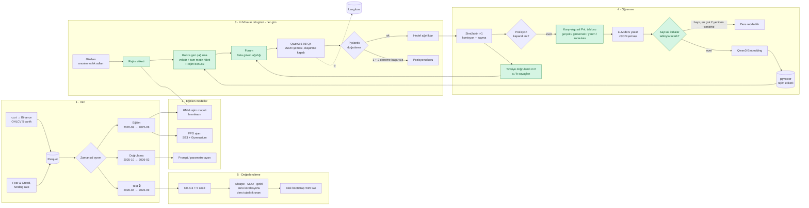

# 4. AI Pipeline

> **Bu belge ne anlatır?** Verinin toplanmasından modellerin eğitilmesine, LLM ajanının günlük kararından işlem sonrası ders çıkarmasına ve deneylerin değerlendirilmesine kadar yapay zekâ hattının tamamını tek diyagramda gösterir. Ayrıca geleceği görme hatasına karşı alınan önlemleri ve deney koşullarını (C0–C3) tanımlar.
>
> **Neden önemli?** Projenin araştırma sorusu (hafıza ve paylaşım işe yarıyor mu?) bu hattaki koşulların karşılaştırılmasıyla cevaplanır. Sonuçların güvenilir olması için modelin test dönemini önceden "bilmemesi" gerekir; bu belge bunun nasıl sağlandığını anlatır.
>
> **İlgili isterler:** [F3 #9](https://github.com/recepbulbul/Mindex/issues/9) · [F7 #13](https://github.com/recepbulbul/Mindex/issues/13) · [F8 #14](https://github.com/recepbulbul/Mindex/issues/14) · [NF2 #17](https://github.com/recepbulbul/Mindex/issues/17) · [NF3 #18](https://github.com/recepbulbul/Mindex/issues/18) · [NF4 #19](https://github.com/recepbulbul/Mindex/issues/19) · [NF5 #20](https://github.com/recepbulbul/Mindex/issues/20)
>
> **İş paketi:** İP1 (tasarım); uygulama İP3–İP6 · **Önceki belge:** [Akış diyagramları](03-flows.md) · **Sonraki belge:** [ER diyagramı](05-er-diagram.md) · Terimler için: [belge dizini ve sözlük](README.md#terimler-sözlüğü)

Yeşil düğümler projenin özgün bileşenleridir: karşı-olgusal post-mortem (işlem kapandıktan sonra "başka ne yapabilirdim?" analizi), rejim farkındalıklı hafıza, güven tabanlı forum.

**Nasıl okunur:** Diyagram soldan sağa beş numaralı bölümden oluşur; her çerçeve bir aşamadır.

1. **Veri:** Binance'ten 5 varlığın günlük fiyatları (OHLCV), Fear & Greed endeksi ve funding rate çekilip Parquet dosyalarına yazılır, sonra zamana göre eğitim / doğrulama / test olarak üçe bölünür. 🔒 işareti test verisinin mühürlü olduğunu, yalnızca nihai değerlendirmede açıldığını gösterir.
2. **Eğitilen modeller:** Eğitim verisiyle piyasa rejimini bulan HMM (gizli Markov modeli, `hmmlearn`) ve pekiştirmeli öğrenme ajanı PPO (Stable-Baselines3 = SB3, Gymnasium ortamında) eğitilir; doğrulama verisiyle prompt ve parametreler ayarlanır.
3. **LLM karar döngüsü:** Her gün ajan gözlem yapar, rejim etiketini alır, hafızasından ilgili dersleri çağırır (anlam benzerliği + PostgreSQL tam metin araması; ayrıntı: [Kalıcı hafıza](#kalıcı-hafıza)), forumu okur ve LLM'den hedef portföy ağırlıklarını ister. İlk deneme ve 2 yeniden deneme (toplam 3) geçerli karar üretmezse pozisyon korunur ([Akış 2](03-flows.md#akış-2--llm-ajan-karar-döngüsü-nf2-nf3)).
4. **Öğrenme:** Karar simülatörde ertesi gün komisyon ve kayma ile yürütülür. Pozisyon kapanınca karşı-olgusal kâr/zarar (PnL) tablosu hesaplanır, LLM bundan bir ders yazar (ayrıntı: [Karşı-olgusal post-mortem](#karşı-olgusal-post-mortem)). Dersteki sayısal iddialar tabloyla çelişiyorsa LLM gerekçeyle yeniden denenir, yine çelişiyorsa ders reddedilir; tutarlıysa vektöre çevrilip (Qwen3-Embedding) rejim etiketiyle hafızaya (pgvector) yazılır. Aynı zamanda forumdaki tavsiyelerin tutup tutmadığı sayılır (`a` / `b`) ve güven skorları güncellenir.
5. **Değerlendirme:** Test döneminde her koşul (C0–C3) 5 farklı seed ile koşulur; Sharpe, MDD (maksimum düşüş), getiri, sürü korelasyonu ve ders tutarlılık oranı hesaplanır. Koşullar arası farkların tesadüf olup olmadığı blok bootstrap ile %95 güven aralığında (GA) sınanır.

Bölümler arasındaki oklar verinin aktığı yönü gösterir; hafızadan (`pgvector`) karar döngüsüne ve güven sayaçlarından foruma geri dönen oklar, ajanın zamanla öğrenmesini sağlayan **geri besleme döngüleridir**. Kesikli ok (`iz` → Langfuse) her LLM çağrısının izleme kaydıdır. **Yeşil kutular** projenin özgün katkılarıdır. Bu diyagramda kırmızı hata kutusu yoktur; "pozisyonu koru" ve "ders reddedilir" dalları buradaki hata/ret yollarıdır, ayrıntıları [akış diyagramlarındadır](03-flows.md).

## Kalıcı hafıza

Kod: `backend/src/mindex/memory/` (`embedder.py`, `store.py`). Her ders `memories` tablosunda; `embedding` (pgvector, 1024 boyut, HNSW) ve `lesson_tsv` (`to_tsvector('simple', lesson)`, GIN) sütunlarıyla tutulur.

- **Yazma:** `MemoryStore.add(...)` dersi `Embedder` ile vektöre çevirir ve oturuma ekler (`flush`; commit çağırana aittir). Gerçekte `LlamaServerEmbedder` llama-server'ın OpenAI uyumlu `/v1/embeddings` ucuna gider (`MINDEX_EMBEDDING_BASE_URL`); testlerde model gerektirmeyen, deterministik `HashEmbedder` kullanılır.
- **Hibrit arama:** `MemoryStore.search(...)` sorguyu vektöre çevirir; ajanın uygun bütün derslerini pgvector kosinüs uzaklığı ve `ts_rank` ile puanlar. Tam metin sorgusu `websearch_to_tsquery('simple', ...)` ile kurulur, ama sorgunun kelimeleri `or` ile bağlanır: varsayılan VE bağlacıyla cümle gibi bir sorgu, yalnızca bütün kelimeleri içeren derslerle eşleşirdi. (`ts_rank` BM25 değildir; PostgreSQL'in yerleşik sıralamasıdır.)
- **Skor birleştirme:** `fuse_scores` saf fonksiyondur ve karşılıklı sıra füzyonu (RRF, `k = 10`) kullanır. İki sinyalin ölçekleri farklı olduğu ve min-max tek aday ya da eşit skorlarda bozulduğu için ağırlıklı min-max yerine RRF seçildi. Hiçbir sorgu kelimesini içermeyen ders tam metin payı almaz. RRF yalnızca sıraya baktığı için uzaklığın büyüklüğünü atar; bu yüzden birleşik değer mutlak kosinüs benzerliğiyle çarpılır (sürekli bir ilgi tabanı). Sabit bir uzaklık eşiği gerçek modelin benzerlik aralığına bağlı olurdu. Sonuç `[0, 1]` aralığındadır (`decision_memories.score`):
  `ilgi = RRF × max(0, 1 − kosinüs_uzaklığı)`
  `skor = ilgi × (0,7 + 0,3 × önem) × (1 + 0,2 × rejim_eşleşmesi) / 1,2`
  **Gerçek sınır:** Önem ve rejim bonusu bir skoru en fazla `1,2 / 0,7 ≈ 1,71` kat büyütür. Yani bir ders, başka bir dersi ancak ilgisi onunkinin yaklaşık %58'i ya da daha fazlasıysa geçebilir. Uzaklığı 0,99 olan ders, 0,01 olanı bonuslarla geçemez; birbirine yakın iki ders arasında ise rejim bonusu sırayı değiştirebilir. Bedeli: vektör benzerliği sıfır olan bir tam metin eşleşmesi 0 puan alır. Sabitler (`RRF_K`, `IMPORTANCE_WEIGHT`, `REGIME_BONUS`) yalnızca doğrulama döneminde ayarlanır.
- **Rejim bonusu:** Dersin rejimi bugünkü rejimle aynıysa ilgi ×1,2 olur. C1′ (`C1_NO_REGIME`) koşulunda `use_regime=False` ile bonus kapanır; diğer her şey C1 ile aynıdır, böylece C1 − C1′ farkı yalnızca bonusun etkisini ölçer.
- **Look-ahead kuralı:** Yalnızca `day < as_of_day` olan dersler döner. Bugün öğrenilen ders bugünkü kararda kullanılamaz. Filtre SQL'in `WHERE` koşulundadır, sonradan elenmez; DB testi aynı günün ve sonraki günün derslerini sorguyla birebir aynı yazıp dönmediklerini kanıtlar.
- **Sahiplik:** Yalnızca o ajanın (`experiment_agent_id`) kendi dersleri döner (C1). Paylaşım forumun işidir (İP6).
- Aday adımında `ORDER BY embedding <=> q LIMIT n` kullanılmaz. HNSW taraması süzmeyi indeks yürüyüşünden sonra yapar ve az anısı olan bir ajan için `k`'den az satır döndürebilir. Bir ajanın bir koşudaki dersi birkaç yüzü geçmez, tam tarama ucuzdur.

## Karşı-olgusal post-mortem

Kod: `backend/src/mindex/postmortem/` (`counterfactual.py`, `lesson.py`). Deney koşucusuna bağlanması sonraki adımdır; modül şimdilik saf fonksiyonlar ve `postmortem(...)` giriş noktasından oluşur.

- **Tetikleme:** Bir *gidiş-dönüş* (round trip), bir ajanın bir varlıktaki dolumlarının sıfırdan sıfıra koşusudur: elde hiç yokken alımla açılır, eldeki miktarı (sayısal toleransla) sıfıra indiren satışla kapanır. Aradaki ekleme ve kısmi satışlar aynı gidiş-dönüşe aittir; kısmi satış post-mortem tetiklemez. `closed_on(fills, day)` o gün kapanan gidiş-dönüşleri verir.
- **Tablo:** Dört senaryo, karşılaştırılabilir olsun diye hepsi gerçek gidiş-dönüşün giriş maliyetine (alım tutarı + komisyon) oranla verilir. Veritabanında `memories.counterfactual = {actual, skip, half, stop_loss}`, API'de `Counterfactual {actual, skip, half, stopLoss}` olarak tutulur.
  - `actual`: gerçekleşen dolumların PnL'i. Dolumlarda kayma ve komisyon zaten vardır.
  - `skip`: hiç girmemek, her zaman 0.
  - `half`: bütün dolumlar yarım miktarla. Kayma ve komisyon orantılı olduğu için tam olarak `actual / 2` çıkar.
  - `stop_loss`: aynı dolumlar, ama gün içi düşük, o ana kadarki alımların ortalama giriş fiyatının (kayma dahil) `(1 − stop_pct)` katına inince elde ne varsa satılır. Varsayılan `stop_pct` %5'tir ve parametreyle değişir. Tetiklenmeden sonraki dolumlar yapılmamış sayılır. Çıkış simülatörün `rebalance` fonksiyonuyla yapılır, yani aynı kayma ve komisyonu öder. Gün eşiğin altında açılırsa (boşluk) satış eşik fiyatından değil, açılıştan yapılır.
- **Look-ahead:** Hesap yalnızca giriş gününden kapanış gününe kadarki barları okur; post-mortem kapanış gününün kapanışında yapılır. Gün içi sıra varsayımı: dolumlar `Fill.day` açılışında gerçekleşir (simülatördeki gibi), düşük açılıştan sonra gelir. Bu yüzden giriş gününün düşüğü zarar-kesi tetikleyebilir, kapanış gününün düşüğü tetikleyemez (pozisyon o açılışta satılmıştır). Test, piyasayı kapanış gününde kesince ya da sonraki barları bozunca sonucun birebir aynı kaldığını kanıtlar.
- **Ders (`postmortem-v1`):** Prompt'ta yalnızca yüzdeler, anonim varlık kodu (`ASSET_x`, `anonymise`) ve elde tutma süresi (gün sayısı) bulunur; fiyat düzeyi ya da takvim tarihi yoktur. Çıktı JSON şemasıyla sınırlıdır: `lesson` (20–2000 karakter), `importance` (0–1), `regime`, `outcome` (kazanç / kayıp / yatay) ve `best_scenario`. Sınırlar `memories` CHECK kısıtlarıyla aynıdır; ihlal veritabanı hatası olarak değil, ret olarak döner. LLM'e erişilemezse ya da JSON bozuksa bu da başarısız deneme sayılır.
- **Sayısal tutarlılık denetimi (`check_consistency`):** Denetim, saklanacak ders metninin kendisine uygulanır.
  - Metindeki her yüzde (`%5,2`, `5.2%`, `-%3`, `+%2`, `yüzde 5`) tablodaki bir değer, zarar-kes eşiği (`-%5` biçiminde de yazılabilir) ya da iki tablo değerinin farkı olmalıdır. Değerler prompt'ta gösterildiği gibi (2 ondalık) alınır, sonra sayının yazıldığı hassasiyete yuvarlanarak karşılaştırılır. Böylece prompt'tan doğru okunan bir sayı çift yuvarlama yüzünden reddedilmez.
  - Açık işaret (`+` / `-`) yazılmışsa tablodaki değerin işaretiyle uyuşmalıdır; işaretsiz sayının büyüklüğü karşılaştırılır.
  - Hiç yüzde içermeyen ders reddedilir. Doğrulanamayan ders tutarlılık oranını şişirirdi.
  - Yön: yalnızca gerçekleşen getiri olabilecek işaretsiz bir yüzdenin aynı yan cümlesinde, hemen önünde ya da ardında ters yönde bir kelime varsa ders reddedilir. Örneğin kayıpta "%10 kazandırdı" ya da "kazancı %10 oldu". Zarar-kes tetiklenmediğinde değeri gerçekleşen getiriye eşittir; bu yüzden aynı sayı belirsiz sayılmaz. Bu bir kök eşleştirmesidir, cümle çözümlemesi değildir: olumsuzluk ("kazandırmadı") ya da başka bir senaryonun da değeri olan bir sayının yönü değerlendirilmez. Bunlar yalnızca açık işaretler ve `outcome` alanıyla denetlenir.
  - `outcome` gerçekleşen getirinin yönüyle, `best_scenario` tablodaki en yüksek senaryoyla (eşitlikte herhangi biriyle) uyuşmalıdır.
  - Gerçek bir varlık adı geçen ders reddedilir. Eşleşme büyük-küçük harf duyarsızdır; ekli ve parite biçimleri de yakalanır (`btc`, `BTCUSDT`, `bitcoinde`, `Ether`). Tek istisna `SOL`: Türkçe "sol" kelimesiyle karışmasın diye yalnızca büyük harfle yakalanır; "Solana" her biçimde yakalanır. Dersler `ASSET_x` koduyla saklanır, ad sonraki anonim karar prompt'larına sızamaz.
- **Yeniden deneme ve ret:** Tutarsız ders, ret gerekçesi konuşmaya eklenerek en çok `MINDEX_LLM_MAX_RETRIES` (≤ 2) kez yeniden istenir. Hâlâ tutarsızsa hafızaya yazılmaz; `PostmortemResult.reason` nedeni verir.
- **Yazma:** Kabul edilen ders `MemoryStore.add(...)` ile `day` = kapanış günü olarak yazılır. Bu yüzden ders, hafıza aramasının `day < as_of_day` kuralıyla ancak ertesi günden itibaren kullanılabilir.
- **Tutarlılık oranı (`consistency_rate`):** Filtrelemeden önce, şemaya uyan bütün üretilmiş derslerin (her deneme) denetimi geçme oranıdır. Hedef ≥ %90'dır. Reddedilenler elendikten sonra saklanan derslerin oranı tanım gereği %100 olacağından, oran ret öncesinde ölçülür.
- **Düşünme modu:** `LlamaCppClient` düşünmeyi kapatır (`enable_thinking: false`), ders adımı da şimdilik böyle çalışır. Düşünme açık bir ders adımı ayrı bir istemci ayarı gerektirir.

## Look-ahead bias protokolü

Look-ahead bias (geleceği görme hatası), modelin karar anında henüz bilinmemesi gereken bilgiye erişmesidir. LLM'ler internetten toplanan verilerle eğitildiği için geçmiş fiyatları ezberlemiş olabilir; bu durumda test sonuçları gerçekçi olmaz. Aşağıdaki dört kural bunu önler. Uygulamadaki karşılığı: [test setinin ayrılması](08-data-pipeline-baseline.md#2-test-setinin-ayrılması-look-ahead-protokolü).

1. Test dönemi (Nisan–Eylül 2026) model yayımından (2 Mart 2026) sonradır.
2. Test verisi yalnızca nihai değerlendirmede açılır; CI'da test Parquet'i okunursa hata verilir.
3. Prompt'larda varlık adları (`ASSET_A`…) ve tarihler (`gün 0…N`) anonimleştirilir.
4. Kasım–Aralık 2026 canlı paper-trading hiç görülmemiş veride ileri testtir.

## Deney koşulları (ablasyon)

Ablasyon, bir sistemin parçalarını tek tek kapatıp her parçanın etkisini ölçmektir. C0'dan C3'e doğru her koşul bir özellik ekler; iki komşu koşulun farkı, eklenen özelliğin etkisini verir. Örneğin C1 − C0 kişisel hafızanın, C3 − C2 güven ağırlığının etkisidir. C1′, rejim bonusunun katkısını ayırmak için eklenmiştir. "Beta" güven ağırlığı, yukarıdaki `(a+1)/(a+b+2)` formülüdür.

| Koşul | Kişisel hafıza | Forum | Güven ağırlığı |
|---|:-:|:-:|:-:|
| C0 | — | — | — |
| C1 | ✔ | — | — |
| C1′ (rejimsiz) | ✔ (rejim bonusu yok) | — | — |
| C2 | ✔ | ✔ | eşit |
| C3 | ✔ | ✔ | Beta |

---

[← Belge dizini](README.md) · [← Önceki: Akış diyagramları](03-flows.md) · [Sonraki: ER diyagramı →](05-er-diagram.md)
