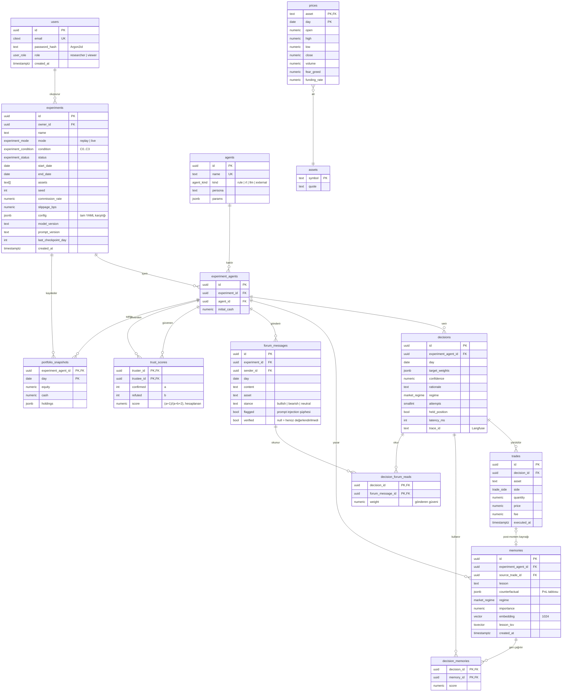

# 5. ER Diyagramı

> **Bu belge ne anlatır?** Mindex veritabanındaki tabloları (varlıkları) ve aralarındaki ilişkileri ER (*Entity-Relationship*, varlık-ilişki) diyagramıyla gösterir; altta önemli tasarım tercihlerini açıklar.
>
> **Neden önemli?** Kullanıcılar, deneyler, ajan kararları, işlemler, hafıza ve forum mesajlarının nasıl birbirine bağlandığını gösterir. Örneğin her işlemin hangi karara, her kararın hangi anılara ve forum mesajlarına dayandığı bu ilişkiler sayesinde izlenebilir (açıklanabilirlik isteri NF4).
>
> **İlgili isterler:** [F1 #7](https://github.com/recepbulbul/Mindex/issues/7) · [F2 #8](https://github.com/recepbulbul/Mindex/issues/8) · [F6 #12](https://github.com/recepbulbul/Mindex/issues/12) · [F7 #13](https://github.com/recepbulbul/Mindex/issues/13) · [F8 #14](https://github.com/recepbulbul/Mindex/issues/14) · [NF2 #17](https://github.com/recepbulbul/Mindex/issues/17) · [NF3 #18](https://github.com/recepbulbul/Mindex/issues/18) · [NF4 #19](https://github.com/recepbulbul/Mindex/issues/19) · [NF5 #20](https://github.com/recepbulbul/Mindex/issues/20)
>
> **İş paketi:** İP2 · **Önceki belge:** [AI pipeline](04-ai-pipeline.md) · **Sonraki belge:** [Veri sözlüğü](06-data-dictionary.md) · Terimler için: [belge dizini ve sözlük](README.md#terimler-sözlüğü)

Veritabanı PostgreSQL 17 ve vektör araması için pgvector eklentisidir. Tabloları oluşturan SQL komutları (DDL, *Data Definition Language*): [`db/schema.sql`](db/schema.sql). Her alanın ayrıntılı açıklaması: [veri sözlüğü](06-data-dictionary.md).

**Nasıl okunur:** Her kutu bir tablodur; içinde alan tipi, alan adı ve varsa anahtar türü yazar: **PK** (*primary key*) satırı benzersiz tanımlayan birincil anahtar, **FK** (*foreign key*) başka tabloya bağlanan yabancı anahtar, **UK** (*unique key*) tekrar edemeyen alandır. Tırnak içindeki notlar alanın anlamını ya da alabileceği değerleri söyler. Kutuları bağlayan çizgilerin uçları ilişkinin sayısını gösterir ("karga ayağı" gösterimi):

- `||` tam olarak bir, `|o` sıfır ya da bir, `o{` sıfır ya da çok, `}o` sıfır ya da çok (ters yönde).
- Örnek: `users ||--o{ experiments : "oluşturur"` → bir kullanıcı sıfır ya da çok deney oluşturur; her deneyin tam olarak bir sahibi vardır.
- `trades |o--o| memories` → bir işlem en fazla bir post-mortem dersine kaynak olur; bir ders de en fazla bir işlemden doğar.

Diyagramın merkezinde `experiment_agents` vardır: bir ajanın belirli bir deneydeki örneğidir. Kararlar, hafıza, forum mesajları ve güven skorları ajana değil bu örneğe bağlanır. `decision_memories` ve `decision_forum_reads` "köprü" tablolarıdır; bir kararda hangi anıların ve hangi forum mesajlarının kullanıldığını kaydeder. `trust_scores` tablosuna `experiment_agents`'tan iki çizgi gelir: biri güvenen, diğeri güvenilen ajandır. Bu diyagramda hata dalı yoktur.

## Tasarım notları

Aşağıdaki maddelerde geçen terimler: UUID rastgele üretilen 128 bitlik kimlik; HNSW vektör benzerlik aramasını hızlandıran indeks; GIN tam metin aramayı hızlandıran indeks; Reciprocal Rank Fusion (RRF) iki ayrı arama sonucunun sıralamalarını tek listede birleştirme yöntemi; checkpoint simülasyonun kaldığı yerden sürdürülebilmesi için kaydedilen durum.

- **UUID birincil anahtarlar** (`uuidv7()` yoksa `gen_random_uuid()`): dış sistemlere (MCP, URL) sıralı ID sızdırmaz.
- **`experiment_agents` köprü tablosu**: aynı ajan farklı deneylerde farklı hafızaya sahip olur; hafıza ve güven deney kapsamındadır, koşullar arası sızıntı olmaz.
- **`trust_scores.score`** üretilmiş sütundur (`GENERATED ALWAYS AS ... STORED`), formül uygulama koduyla aynıdır (`mindex.domain.trust`).
- **Hibrit arama**: `memories.embedding` üzerinde HNSW (cosine), `lesson_tsv` üzerinde GIN; sonuçlar Reciprocal Rank Fusion ile birleşir.
- **`prices`** yalnızca canlı mod ve ekran için önbellektir; deneyler tekrarlanabilirlik için sürümlü Parquet anlık görüntülerinden okur.
- **`portfolio_snapshots`** gün bazlı checkpoint görevi de görür (NF2).

---

[← Belge dizini](README.md) · [← Önceki: AI pipeline](04-ai-pipeline.md) · [Sonraki: Veri sözlüğü →](06-data-dictionary.md)
