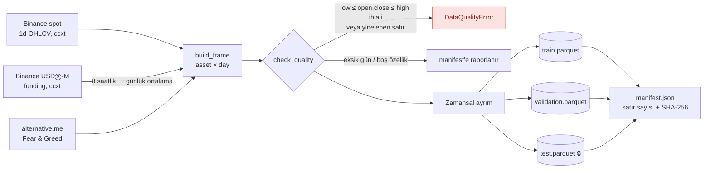

# 8. Veri Hattı, Simülatör ve Baseline (P3)

> **Bu belge ne anlatır?** Projenin gerçek veriyle çalışan ilk kodunu anlatır: Binance'ten veri çekme, test verisini mühürleme, işlem simülatörü, kural tabanlı ajanlar ve ilk LLM ajanı. Ardından LLM'in hızını ölçer ve ilk sonuçları öneri formundaki nicel hedeflerle karşılaştırır.
>
> **Neden önemli?** Önceki belgeler tasarımdı; bu belge ilk somut sonuçtur. Hedeflerden biri (LLM hızı) karşılandı, biri (MDD) karşılanmadı, bazıları henüz ölçülemedi. Hangisinin neden böyle olduğu [6. bölümün sonundaki özette](#sonuclar-ozet) açıkça yazılıdır.
>
> **İlgili isterler:** [F3 #9](https://github.com/recepbulbul/Yunus_Hoca_Proje/issues/9) · [F8 #14](https://github.com/recepbulbul/Yunus_Hoca_Proje/issues/14) · [F9 #15](https://github.com/recepbulbul/Yunus_Hoca_Proje/issues/15) · [NF1 #16](https://github.com/recepbulbul/Yunus_Hoca_Proje/issues/16) · [NF2 #17](https://github.com/recepbulbul/Yunus_Hoca_Proje/issues/17) · [NF5 #20](https://github.com/recepbulbul/Yunus_Hoca_Proje/issues/20)
>
> **İş paketi:** İP3 ([#23](https://github.com/recepbulbul/Yunus_Hoca_Proje/issues/23), kapalı) · **Önceki belge:** [Teknoloji yığını](07-tech-stack.md) · **Sonraki belge:** [Arayüz tasarım sistemi](09-design-system.md) · Terimler için: [belge dizini ve sözlük](README.md#terimler-sözlüğü)

Hafta 3 iş paketi (öneri formu İP3; belgelerde kısaca P3): ccxt (borsalara ortak arayüz sunan Python kütüphanesi) ile veri hattı, EDA (*Exploratory Data Analysis*, keşifsel veri analizi) notebook'u, test setinin ayrılması; simülatör çekirdeği, kural tabanlı ajanlar ve ilk LLM ajanı (baseline, yani sonraki koşulların karşılaştırılacağı temel ölçüm); llama.cpp hız ölçümüyle hesap bütçesinin doğrulanması; ilk metriklerin nicel hedeflerle karşılaştırılması.

> **Kısa sonuç:** LLM karar hızı hedefi **karşılandı** (p95 5,26 sn < 10 sn). Maksimum düşüş (MDD) hedefi **karşılanmadı** (LLM ajanı BTC al-ve-tut'tan yalnızca %2,9 iyi, hedef ≥ %30). Hafıza ve forum gerektiren C3 hedefi **henüz ölçülemedi**, çünkü bu bileşenler İP5–İP6'da yazılacak. Ayrıntılar ve nedenler: [sonuçların özeti](#sonuclar-ozet).

| Çıktı | Konum | Durum |
|---|---|---|
| ccxt veri hattı + Parquet anlık görüntüleri | [`mindex.data`](../backend/src/mindex/data/), `uv run mindex fetch-data` | ✅ gerçek veriyle çalıştırıldı |
| Test setinin ayrılması ve mühürlenmesi | [`mindex.data.splits`](../backend/src/mindex/data/splits.py) | ✅ |
| EDA notebook'u | [`backend/notebooks/01-eda.ipynb`](../backend/notebooks/01-eda.ipynb) | ✅ çıktılarıyla birlikte |
| Simülatör çekirdeği | [`mindex.sim`](../backend/src/mindex/sim/) | ✅ |
| Kural tabanlı ajanlar (3) | [`mindex.agents.rule`](../backend/src/mindex/agents/rule.py) | ✅ |
| İlk LLM ajanı (C0 baseline) | [`mindex.agents.llm`](../backend/src/mindex/agents/llm.py) | ✅ Qwen3.5-9B ile doğrulama döneminde koşuldu |
| llama.cpp hız ölçümü, hesap bütçesi | [`reports/llm-benchmark.json`](../reports/llm-benchmark.json), `uv run mindex bench-llm` | ✅ p95 5,26 sn; bütçe 22,8–26,7 sa |
| İlk metrikler ve hedef karşılaştırması | [`reports/baseline-validation.md`](../reports/baseline-validation.md), `uv run mindex baseline --llm` | ✅ kural ajanları + LLM ajanı |

## Komutlar

```bash
cd backend
uv sync
uv run mindex fetch-data                 # Binance + Fear & Greed → data/snapshots/*.parquet + manifest.json
uv run mindex baseline                   # doğrulama döneminde kural ajanları → reports/baseline-validation.{md,json}
uv run mindex bench-llm --calls 30       # llama-server açıkken: karar çağrısı gecikmesi → reports/llm-benchmark.json
uv run mindex baseline --llm             # ilk LLM ajanını da koştur (llama-server gerekir)
uv sync --group eda && uv run jupyter nbconvert --to notebook --execute --inplace notebooks/01-eda.ipynb
```

LLM adresi ve modeli `.env` dosyasından okunur (`MINDEX_LLM_BASE_URL`, `MINDEX_LLM_MODEL`, `MINDEX_LLM_TIMEOUT_SECONDS`, `MINDEX_LLM_MAX_RETRIES`; bkz. [`.env.example`](../.env.example)).

## 1. Veri hattı



**Nasıl okunur:** Soldan sağa okunur. Soldaki üç kutu veri kaynaklarıdır: Binance spot piyasasının günlük fiyatları (OHLCV), Binance vadeli işlem (USDⓈ-M) piyasasının 8 saatte bir açıklanan funding oranı (okun üstünde yazdığı gibi günlük ortalamaya çevrilir) ve alternative.me'nin Fear & Greed endeksi. `build_frame` bunları her satırı bir varlık-gün olan tek tabloda birleştirir. Eşkenar dörtgen (`check_quality`) veri kalite kontrolüdür ve üç çıkışı vardır:

- **Kırmızı kutu (`DataQualityError`):** fiyatlar mantıksızsa (örneğin kapanış, günün en yüksek fiyatından büyükse) ya da aynı satır iki kez geldiyse veri hattı durur; bozuk veriyle deney yapılmaz.
- **Eksik gün / boş özellik:** daha hafif sorunlar hattı durdurmaz, `manifest.json` dosyasına raporlanır.
- **Sorun yoksa** veri zamana göre eğitim, doğrulama ve test dosyalarına bölünür (🔒 = mühürlü test verisi). Silindirler diske yazılan Parquet dosyalarıdır. En sağdaki `manifest.json` her dosyanın satır sayısını ve SHA-256 özetini (dosyanın parmak izi) tutar; dosya sonradan değişirse fark edilir.

- **Kaynaklar:** Binance spot günlük mumları (`BTC/USDT` … `XRP/USDT`), Binance USDⓈ-M perpetual funding oranı (günlük ortalama) ve alternative.me Fear & Greed endeksi. Hepsi açık uçlardan çekilir, API anahtarı gerekmez (NF3).
- **Sayfalama:** ccxt'nin 1000 mumluk sayfaları ileriye doğru taranır; borsa ilerleme göstermezse döngü durur. Bu mantık sahte borsalarla test edilir, ağa yalnızca `CcxtSpot` ve `CcxtFutures` adaptörleri çıkar.
- **Biçim:** `prices` tablosuyla aynı uzun format (bkz. [veri sözlüğü](06-data-dictionary.md#prices)): `asset, day, open, high, low, close, volume, fear_greed, funding_rate`.
- **Tekrarlanabilirlik (NF5):** Deneyler borsadan değil anlık görüntülerden okur. `load_split` her okumada dosyanın SHA-256 özetini manifest'le karşılaştırır, değişmiş dosyayı reddeder. Parquet dosyaları `.gitignore`'dadır; [`data/snapshots/manifest.json`](../data/snapshots/manifest.json) commitlenir. Böylece aynı veri yeniden çekildiğinde özetlerden doğrulanabilir.

İlk çekimin sonucu (2026-11-03):

| Split | Dönem | Satır (5 varlık) | Eksik gün |
|---|---|--:|--:|
| train | 2020-09-01 → 2025-09-30 | 9280 | 0 |
| validation | 2025-10-01 → 2026-03-31 | 910 | 0 |
| test 🔒 | 2026-04-01 → 2026-09-30 | 915 | 0 |

Fear & Greed'de 5, funding oranında 12 boş satır var. Ajanlar bu değerleri `null` olarak görür.

## 2. Test setinin ayrılması (look-ahead protokolü)

Pencereler [`mindex.data.splits.SPLITS`](../backend/src/mindex/data/splits.py) içinde tek yerde tanımlıdır ve [AI pipeline](04-ai-pipeline.md#look-ahead-bias-protokolü) ile aynıdır. Test penceresi model yayımından (2 Mart 2026) sonra başlar; bu bir testle de güvenceye alınmıştır.

- Test split'i `unseal=True` verilmeden okunamaz (`SealedTestSetError`). CLI'da bunun karşılığı `--unseal` bayrağıdır.
- `CI` ortam değişkeni tanımlıysa test split'i `unseal=True` ile bile okunmaz. Bu, protokoldeki "CI'da test Parquet'i okunursa hata verilir" maddesinin uygulamasıdır.
- Doğrulama penceresinin ilk günlerinde göstergeler için gereken 31 günlük geçmiş, `load_window(..., lookback_days=31)` ile **önceki** split'ten alınır. Bu yalnızca geçmişe doğru olduğu için sızıntı yaratmaz.
- LLM prompt'unda varlık adları `ASSET_A`… ile, tarihler gün numarasıyla anonimleştirilir.

## 3. Simülatör çekirdeği

[`mindex.sim.engine.Simulator`](../backend/src/mindex/sim/engine.py) öneri formundaki yürütme modelini uygular.

- `t` gününün kapanışında her ajan bir `Observation` alır ve hedef ağırlıklar (`Decision`) döndürür, ya da `None` döndürerek portföyünü korur.
- Emirler `t+1` açılışında yürütülür. Alımda fiyat `open × (1 + 5 bp)`, satımda `open × (1 − 5 bp)`; tutar üzerinden %0,1 komisyon alınır.
- Önce satışlar, sonra alımlar yapılır. Komisyon nakdi eksiye düşürecekse alımlar orantılı küçültülür: kaldıraç ve açığa satış yoktur.
- Özsermayenin %0,1'inden küçük düzeltmeler yapılmaz, böylece ağırlık kayması gereksiz komisyon üretmez.
- **Geleceği görmeme:** Ajan piyasayı yalnızca `MarketView(t)` üzerinden görür; `closes`, `bar`, `fear_greed` ve `funding_rate` hiçbir zaman `t` sonrasını döndürmez.
- **Checkpoint (NF2):** `SimState` her günden sonra JSON'a yazılabilir. Yarıda kesilip sürdürülen bir koşu, kesintisiz koşuyla bayt düzeyinde aynı sonucu verir (`test_checkpoint_resume_is_identical`). Bu, [Akış 1](03-flows.md#akış-1--deney-oluşturma-ve-yürütme-f2-f3-nf2)'deki "son checkpoint'ten devam" dalının çekirdeğidir.

## 4. Ajanlar

Tüm yerel ajanlar [`BaseAgent`](../backend/src/mindex/agents/base.py) arayüzünü uygular (F9). `decide` yalnızca gözleme bağlıdır; bu da aynı seed ile birebir aynı sonucu ve checkpoint'ten sürdürmeyi mümkün kılar.

| Kimlik | Tür | Kural |
|---|---|---|
| `buy-hold-btc` | rule | İlk gün tüm nakitle BTC alır, sonra işlem yapmaz |
| `equal-weight` | rule | 5 varlığa 1/5 pay; 30 günde bir yeniden dengeler |
| `ma-cross` | rule | MA(10) > MA(30) olan her varlığa 1/5 pay, kalanı nakit; sinyal kümesi değişmedikçe işlem yapmaz |
| `llm-momentum` | llm | İlk LLM ajanı. C0 koşulu: hafıza ve forum yok |

Kimlikler ve parametreler prototipteki ajanlarla aynıdır (`frontend/src/mocks/fixtures.ts`).

### İlk LLM ajanı

[Akış 2](03-flows.md#akış-2--llm-ajan-karar-döngüsü-nf2-nf3)'nin hafıza ve forum dışındaki adımları uygulanmıştır.

1. **Gözlem:** Her varlık için son 30 günlük getiriler (%), 7 ve 30 günlük getiri, 30 günlük yıllık volatilite, kapanışın MA(10) ve MA(30)'a uzaklığı, funding oranı; ayrıca Fear & Greed ve mevcut portföy ağırlıkları. Varlık adları ve tarihler anonimdir.
2. **Çağrı:** llama.cpp `llama-server`'ın OpenAI uyumlu `/chat/completions` ucu kullanılır. `temperature = 0`, sabit seed, `enable_thinking = false` ve anonim varlık kodlarıyla sınırlanmış JSON şeması gönderilir (ADR-4). Prompt sürümü `decision-v1`'dir (NF5).
3. **Doğrulama:** Gelen yanıt gerçek varlık adlarına geri çevrilir ve P1'deki `decide_with_retries` ile doğrulanır. Bozuk JSON, şema ihlali, zaman aşımı ve bağlantı hatası başarısız deneme sayılır; 1 + 2 denemeden sonra pozisyon korunur.
4. **Kişilikler:** `momentum`, `mean-reversion`, `sentiment`, `risk-averse` tanımlıdır. P3'te yalnızca `momentum` koşulur; dördü birlikte P6'da devreye girer.

Bu iş paketinin dışında kalanlar: hafıza (P5), forum (P6), PydanticAI'ye geçiş ve Langfuse izleri (P6), yanıt önbelleği (P6).

## 5. llama.cpp hız ölçümü ve hesap bütçesi

Öneri formundaki risk tablosuna göre ana deneyin bütçesi ≈ 50 saattir.

| Değişken | Değer |
|---|---|
| Test dönemi günü | 183 |
| LLM ajanı | 4 |
| Koşul | 5 (C0, C1, C1′, C2, C3) |
| Seed | 5 |
| **Karar çağrısı** | **183 × 4 × 5 × 5 = 18 300** |
| 50 saate sığmak için çağrı başına üst sınır | **9,84 sn** |
| p95 = 10 sn olsaydı toplam süre | 50,8 sa |

Sonuç olarak NF1'deki "p95 < 10 sn" hedefi ile 50 saatlik bütçe aynı koşulu söyler. Çağrıların büyük kısmı p95'in altında kalacağı için gerçek süre daha kısa olur. Yeniden denemeler ve doğrulama dönemindeki ayar koşuları bu hesaba dahil değildir.

### Ölçüm sonucu

`uv run mindex bench-llm --calls 30`, Qwen3.5-9B Q4_K_M'yi `llama-server` ile çalıştıran 8 GB VRAM'li dizüstünde, doğrulama döneminin gerçek gözlemleriyle koşuldu ([`reports/llm-benchmark.json`](../reports/llm-benchmark.json)).

| Ölçüm | Değer |
|---|---|
| Çağrı | 30 (`momentum` kişiliği) |
| Geçersiz JSON | 0 |
| p50 / p95 / maksimum | 4,48 / 5,26 / 5,55 sn |
| 18 300 çağrı, p50 ile | 22,8 sa |
| 18 300 çağrı, p95 ile | 26,7 sa |

NF1 hedefi (p95 < 10 sn) karşılandı ve ana deney 50 saatlik bütçenin yaklaşık yarısına sığıyor. Risk tablosundaki B planına (Qwen3.5-4B, daha az ajan veya seed, yanıt önbelleği) gerek yok. Kalan pay, P5–P6'da prompt'a eklenecek hafıza ve forum bağlamının uzattığı çağrıları ve yeniden denemeleri karşılar. Bu bağlam eklendiğinde ölçüm tekrarlanmalıdır, çünkü giriş uzadıkça gecikme artar.

<a id="sonuclar"></a>

## 6. İlk metrikler ve nicel hedefler

Tablolardaki ölçütler: **Getiri** dönem sonu portföy değerinin başlangıca göre değişimi; **Sharpe** riske göre düzeltilmiş getiri (yüksek olan iyi); **MDD** (maksimum düşüş) portföyün zirvesinden gördüğü en derin düşüş (düşük olan iyi); **İşlem** toplam alım-satım sayısı; **Komisyon** borsaya ödenen toplam ücret. Tanımlar için [sözlüğe](README.md#terimler-sözlüğü) bakın. Tüm ajanlar 10 000 USDT ile başlar.

Koşu doğrulama döneminde yapıldı (2025-10-01 → 2026-03-31), çünkü test dönemi mühürlüdür. Tam tablo [`reports/baseline-validation.md`](../reports/baseline-validation.md) dosyasındadır.

| Ajan | Getiri | Sharpe | MDD | İşlem | Komisyon |
|---|--:|--:|--:|--:|--:|
| buy-hold-btc | −%42,5 | −1,95 | %49,5 | 1 | 10 $ |
| equal-weight | −%50,6 | −1,94 | %57,5 | 33 | 12 $ |
| ma-cross | −%21,8 | −1,88 | %26,3 | 61 | 62 $ |
| llm-momentum (C0) | −%42,9 | −2,60 | %48,1 | 557 | 512 $ |

| Nicel hedef (öneri formu) | Durum |
|---|---|
| C3 LLM ortalama Sharpe'ı C0'a göre ≥ %15 yüksek | Ölçülmedi. Hafıza ve forum P5–P6'da gelecek; bu koşu yalnızca C0 baseline'ını kurar |
| En iyi LLM ajanının MDD'si BTC al-ve-tut'tan ≥ %30 düşük | **Karşılanmadı.** `llm-momentum` MDD %48,1, al-ve-tut %49,5: yalnızca %2,9 düşük. Aynı dönemde `ma-cross` %47 düşürdü, yani hedef nakde geçebilen bir ajan için ulaşılabilir |
| Post-mortem derslerinde ≥ %90 sayısal tutarlılık | Ölçülmedi (P5) |
| Karar çağrısı p95 < 10 sn | **Karşılandı.** p95 5,26 sn (n = 30); bkz. bölüm 5 |
| tick → ekran p95 < 500 ms, 50 izleyicide hata < %1 | Ölçülmedi (P7–P9) |

Gözlemler:

- Doğrulama dönemi sert bir düşüş dönemi: BTC −%42,5. Risk tablosundaki "test dönemi sert düşüşe denk gelir" senaryosunun benzeri burada yaşandı. Bu yüzden ölçüt mutlak getiri değil, al-ve-tut'a göre Sharpe ve MDD'dir.
- Sürü korelasyonu (yatırılan ağırlığın günlük değişimi) kural ajanları için 0,42 idi; LLM ajanı eklenince 0,26'ya düştü. LLM ajanı kural ajanlarından farklı zamanlarda pozisyon değiştiriyor.
- **LLM ajanı aşırı işlem yapıyor.** 181 günün hepsinde yeni hedef ağırlık verdi (hiç "değişiklik yok" demedi, hiç geçersiz yanıt da olmadı). Simülatör, hedef ile mevcut ağırlık arasındaki farkı %0,1'in üzerindeyse işleme çevirdiği için günde ortalama 3 işlem oluştu. 512 $ komisyon başlangıç sermayesinin %5,1'i. Getirisi BTC al-ve-tut'la neredeyse aynı (−%42,9 / −%42,5), Sharpe'ı ise maliyet yüzünden daha kötü (−2,60 / −1,95).
- Bu, hafıza ve forumun etkisinin ölçüleceği C0 tabanıdır ve P5–P6 için iki somut iş çıkarır: prompt'a "pozisyonu koru" seçeneğini ve işlem maliyetini açıkça vermek (`decision-v2`), gözleme son işlemlerden bu yana geçen gün sayısını eklemek. Bu değişiklikler prompt sürümüyle kaydedilir; C0 sonuçları `decision-v1` ile karşılaştırılabilir kalır.
- EDA bulguları (kalın kuyruklar, 0,46–0,80 getiri korelasyonu, zayıf Fear & Greed sinyali) [notebook'un sonunda](../backend/notebooks/01-eda.ipynb) özetlenmiştir.

<a id="sonuclar-ozet"></a>

### Sonuçların özeti: ne tuttu, ne tutmadı, neden?

Bu bölüm yukarıdaki tablolardaki bulguları tek yerde ve nedenleriyle toplar. Yeni ölçüm içermez.

**✅ Karar hızı hedefi karşılandı (NF1).** Öneri formu, bir LLM karar çağrısının %95 oranında 10 saniyenin altında bitmesini istiyor. Ölçülen p95 5,26 sn. Bu, ana deneyin 50 saatlik hesap bütçesinin yaklaşık yarısına (22,8–26,7 sa) sığdığı anlamına gelir; daha küçük bir modele geçmeye gerek yok ([bölüm 5](#5-llamacpp-hız-ölçümü-ve-hesap-bütçesi)). Ölçüm hafıza ve forum bağlamı olmadan yapıldı; bunlar prompt'u uzatacağı için İP5–İP6'da tekrarlanacak.

**❌ MDD hedefi karşılanmadı.** Hedef: en iyi LLM ajanının maksimum düşüşü BTC al-ve-tut'tan en az %30 düşük olmalı. Al-ve-tut'un MDD'si %49,5 olduğuna göre hedef ≈ %34,7 veya altıdır. `llm-momentum` ajanının MDD'si %48,1, yani yalnızca %2,9 düşük. Nedenleri:

1. **Ajan düşüşte riskini azaltmadı.** Getirisi (−%42,9) ve MDD'si (%48,1) BTC al-ve-tut'la neredeyse aynı. Bu, sert düşen bir dönemde ajanın portföyünü belirgin biçimde nakde çekmediğini gösteriyor. Aynı dönemde nakde geçebilen basit `ma-cross` kuralı MDD'yi %47 azalttı; yani hedef ulaşılamaz değil.
2. **Ajan aşırı işlem yaptı.** 181 günün hepsinde yeni bir hedef dağılım verdi, hiç "değişiklik yok" demedi. Bu 557 işlem ve başlangıç sermayesinin %5,1'i kadar (512 $) komisyon üretti; Sharpe'ı bu yüzden al-ve-tut'tan da kötü çıktı (−2,60 / −1,95).
3. **Prompt'un ilk sürümü (`decision-v1`) bu davranışı teşvik ediyor.** Ajana "pozisyonu koru" seçeneği ve işlem maliyeti açıkça verilmiyor, son işlemden bu yana kaç gün geçtiği de gözlemde yok.
4. **Bu ölçüm bir ara ölçümdür.** Koşu tek kişilikle (`momentum`), yalnızca C0 koşulunda (hafıza ve forum yok) ve doğrulama döneminde yapıldı. Hedefin nihai değerlendirmesi test döneminde, dört kişilik ve tüm koşullarla yapılacak.

Sonraki adım: `decision-v2` prompt'u (pozisyonu koru seçeneği + işlem maliyeti) ve gözleme "son işlemden beri geçen gün" eklenmesi; ölçüm İP5–İP6'da tekrarlanacak. `decision-v1` sonuçları C0 tabanı olarak saklanır.

**⏳ C3 hedefi henüz ölçülemedi.** Hedef: hafıza ve güven ağırlıklı forumu olan C3 koşulundaki LLM ajanlarının ortalama Sharpe'ı, hafızasız C0'dan en az %15 yüksek olmalı. C3'ün iki bileşeni henüz yazılmadı: hafıza İP5'te, forum İP6'da gelecek. Bu yüzden şu an yalnızca C0 koşulabiliyor ve karşılaştırma yapılamıyor. Bu koşunun görevi, C3'ün karşılaştırılacağı C0 tabanını kurmaktı. C0–C3 karşılaştırması İP6'daki koşularla başlayacak.

**⏳ Diğer ölçülmeyen hedefler.** Post-mortem derslerinin sayısal tutarlılığı (≥ %90) post-mortem İP5'te yazılınca, ekran gecikmesi ve 50 izleyici hedefi canlı ekran ve yük testi İP7–İP9'da hazır olunca ölçülecek.

## Doğrulama

- `uv run ruff format --check .`, `uv run ruff check .`, `uv run pyright` (strict) ve `uv run pytest` lokalde geçiyor: 72 test, kapsam %94.
- Polars 2'nin tip imzaları strict pyright'ta "partially unknown" uyarısı veriyor. Bu yüzden `reportUnknownMemberType` yalnızca Polars kullanan dosyalarda kapatıldı. ccxt tip dosyası içermediği için ccxt çağrıları iki adaptör sınıfında toplanıp `cast` edildi.

---

[← Belge dizini](README.md) · [← Önceki: Teknoloji yığını](07-tech-stack.md) · [Sonraki: Arayüz tasarım sistemi →](09-design-system.md)
